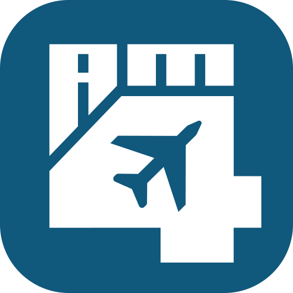
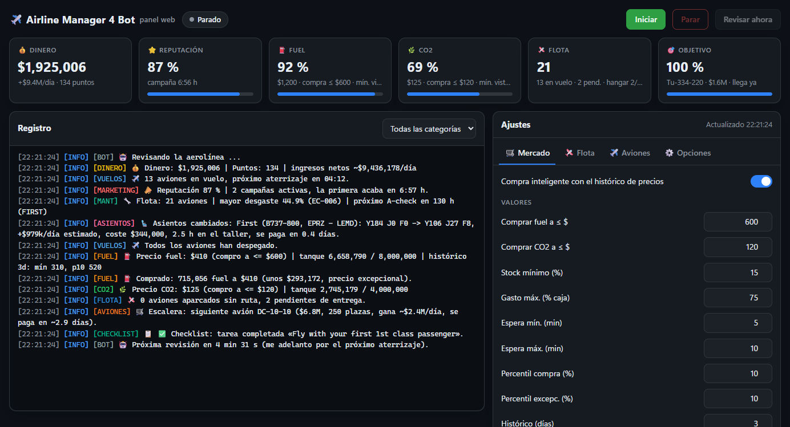
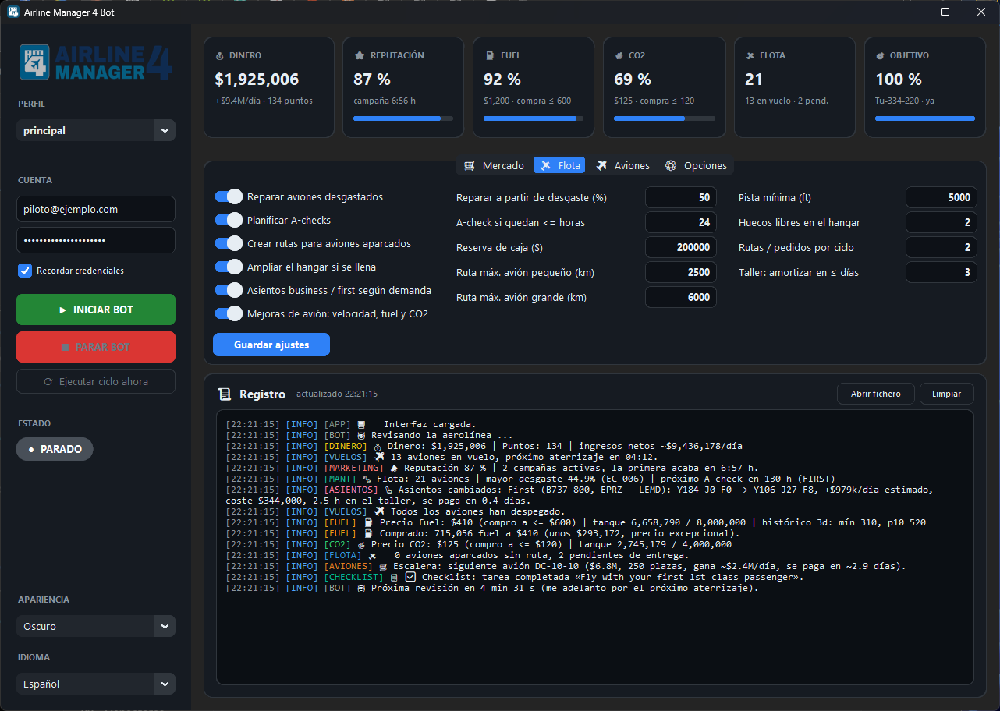
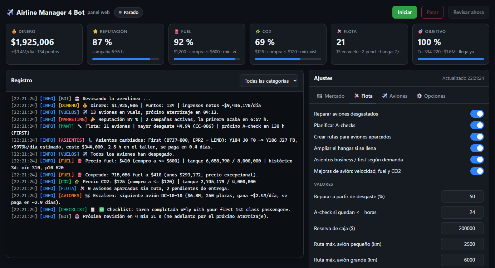
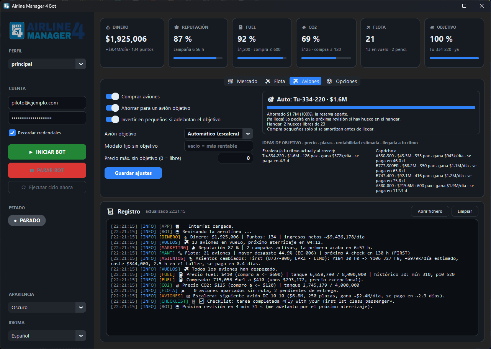
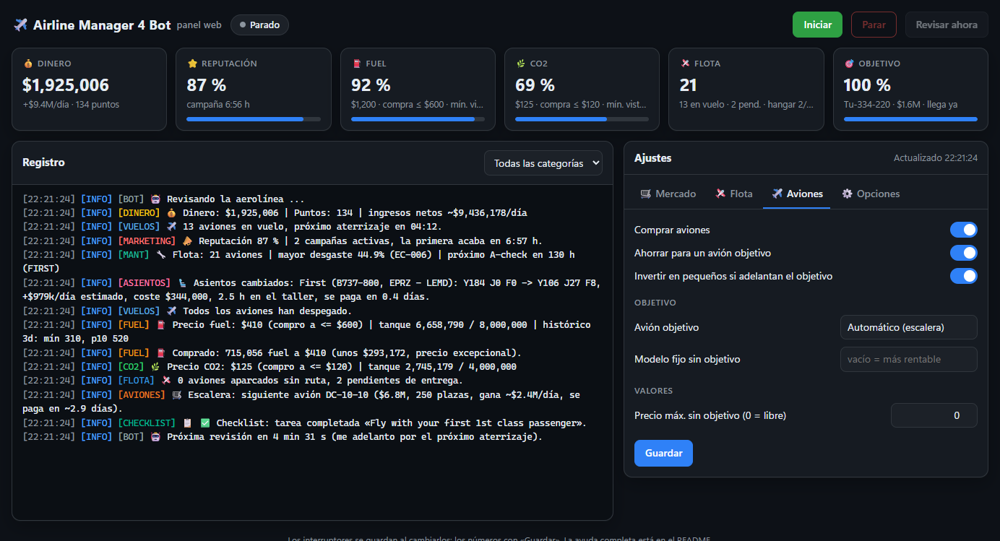
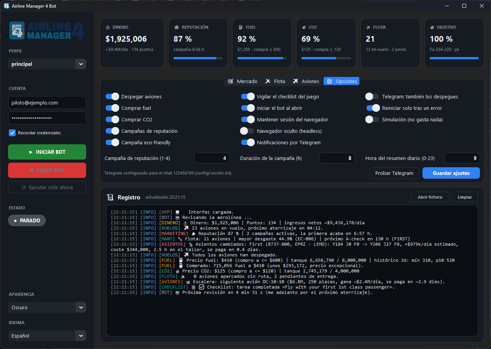
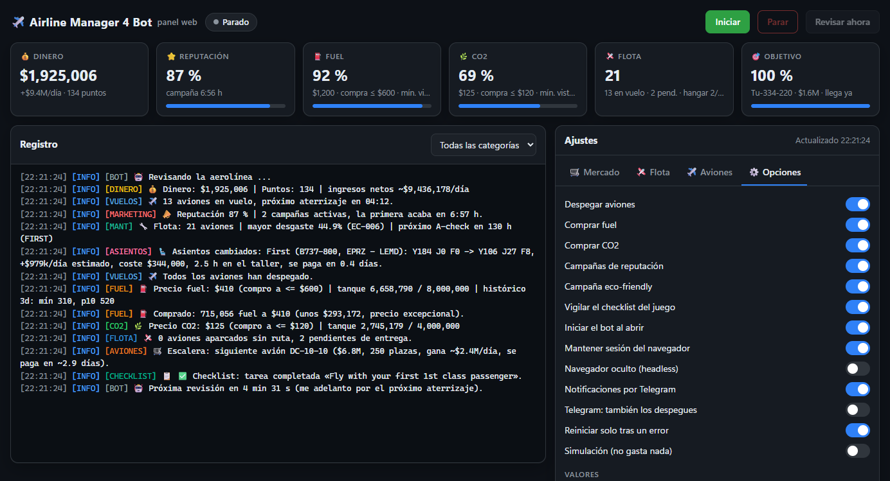
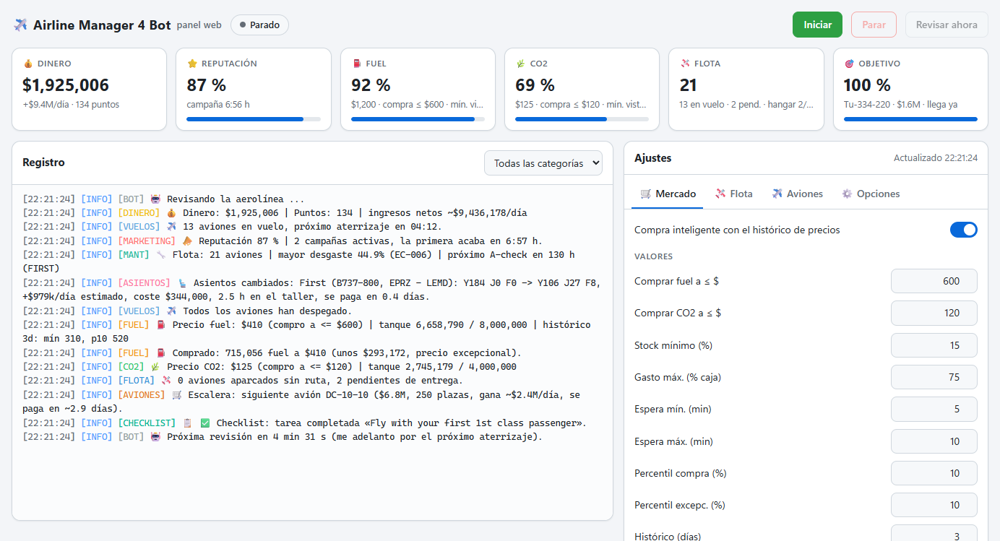

<div align="center">
    
    <h1>Airline Manager 4 Bot</h1>
    <p>Desktop bot for the web version of <a href="https://www.airlinemanager.com">Airline Manager 4</a>: departs your aircraft, buys fuel and CO2 when they are cheap, keeps the fleet repaired, runs marketing campaigns, fits business and first class seats to each route, gives parked aircraft a route and buys the best-value aircraft. Desktop window and web dashboard.</p>
    
</div>

**Idioma padrão: Português (Brasil).** [Guia completo das configurações](#guia-do-aplicativo-em-português-brasileiro).

## Features

- ✔️ Auto depart all aircraft.
- ✔️ Auto buy fuel and CO2. Smart buy keeps a price history (`data/prices.json`, fed by the market chart, so it covers the last 5 hours even when the bot was off) and fills the tanks when the price is in the low percentile of the last days. A fixed "always buy at" price and a minimum stock top-up complete the rule. Buys once per 30-minute price window and never more than your free storage, your cash reserve or the per-purchase cap allow.
- ✔️ Wakes up early when an aircraft is about to land or the market price is about to change, instead of waiting the full interval.
- ✔️ Auto repair aircraft above a wear percentage and plan A-checks when the hours to check run low.
- ✔️ Create routes for parked aircraft: searches the busiest routes from your hub, checks the aircraft can fly them, uses the game's autoprice.
- ✔️ Buy the best-value aircraft (estimated daily profit divided by price) or a model you name, never below your cash reserve and never while aircraft sit parked without a route.
- ✔️ Growth ladder: by default the goal is automatic. The bot saves for the aircraft that earns the most per day among those costing at most `ladder_budget_days` of income and paying back within `ladder_max_payback` days, so it climbs to bigger aircraft as income grows (today: MD-81, then MC-21-300, then MC-21-400). You can also pick a fixed goal (A330, B777, B747, A380 ...). Meanwhile it only buys a smaller aircraft when it pays for itself in less than half the time left to the goal. Shows progress, net income per day and the estimated arrival.
- ✔️ Profit estimates calibrated on the airline's own flights: the bot measures the real seat occupancy every cycle (it follows the airline reputation) and uses the price it actually pays for fuel and CO2.
- ✔️ Keeps free hangar slots: buys one more slot when they run low.
- ✔️ Marketing: keeps an airline reputation campaign (level and duration configurable) and the cheap eco-friendly campaign running, but only while they pay. Seat occupancy follows the reputation, so a campaign multiplies the ticket income the bot measures by the points it adds over the current reputation; if that does not beat its price by 20 %, it is skipped (with a small fleet in realism, campaign 4 does not pay and the eco-friendly one does). A reputation campaign waits until 6 h of income have been measured.
- ✔️ Fuel and CO2 stock in days: it never holds more than `stock_days` of what the fleet burns (twice that at an exceptional price), so the money goes to new aircraft instead of sitting in the tanks for weeks. The net income counts fuel and CO2 when they are burnt, not when they are bought.
- ✔️ Seat layout by route demand: when an aircraft sits at the base, the bot reads its route's daily Y / J / F demand and gives it first and business seats up to that demand, the rest economy (per economy slot first pays the most, then business). It only modifies an aircraft when the cost plus the workshop time pays back within `seats_max_payback` days.
- ✔️ Aircraft upgrades: in the same workshop visit it works out what each permanent upgrade of the game would earn on that aircraft's route (speed +10 % = more flights a day as far as demand allows, fuel -10 %, CO2 -10 %) and installs those that pay back within `seats_max_payback` days.
- ✔️ Watches the game's checklist: logs the open tasks, reports the completed ones and collects rewards when the game offers a button. While "fly your first 1st class passenger" ($100,000) is open, the seat step counts that reward on the first aircraft it can give first-class seats.
- ✔️ Exceptional prices (lowest percentile of the history) fill the tanks with all the cash above the reserve.
- ✔️ The lowest fuel and CO2 prices ever seen appear next to the price boxes, as a reference of what "cheap" really is.
- ✔️ Hover tooltips on every button and setting; the full guide is below, in Spanish like the app.
- ✔️ Dry run mode: logs every purchase, repair, route or order it would make without spending anything.
- ✔️ Dashboard window: statistic tiles (money and income, reputation and campaign time left, fuel and CO2 tanks with prices, fleet, savings goal), the settings tabs and a colour-coded, tagged log that is always visible. Dark and light themes.
- ✔️ Web dashboard: the same tiles, log, controls and settings in a browser, also on your phone from the home network (with a token). It can also run without the desktop window (`python src/main.py --web`), for a machine that stays on all day.
- ✔️ Telegram notifications for every action, errors and a daily summary.
- ✔️ Automatic restart after a crash, so it can run unattended for days.
- ✔️ Random interval between checks, optional headless Chrome, optional persistent browser session.
- ✔️ Credentials live in `config/secrets.ini`, which is git-ignored.

<details>
<summary><b>📸 All screenshots</b> (desktop window and web dashboard, every tab, dark and light)</summary>

| Desktop window | Web dashboard |
| --- | --- |
|  |  |
|  |  |
|  |  |
|  |  |
|  |  |
| |  |

The images use sample figures and an example account. To refresh all of them after a change: `.venv\Scripts\python.exe scripts\screenshots.py` (it never starts the bot and works while the bot is running).
</details>

Works in both game modes: the bot reads the mode of each account (easy: flights at 1.5x speed; realism: real speed and cheaper tickets) and adapts its profit, route and seat calculations to it.

The window and the web dashboard speak English (default) or Spanish (**Idioma / Language** in the sidebar, switched live). Your game account is left alone until you pick a language there; from then on it follows that language at the next check (`[options] sync_game_language = off` to keep them apart). The log and the Telegram messages are in Spanish for now. The game itself can be in any language: the bot finds everything by ids, classes and click handlers, never by visible text (tested with the game in English and in Spanish).

## Requirements

- Python 3.10 or newer.
- Google Chrome. Selenium Manager downloads the matching chromedriver by itself, nothing to install by hand.

## Install

```bash
git clone https://github.com/JavierOlmedo/AirlineManager4Bot.git
cd AirlineManager4Bot
python -m venv .venv
.venv\Scripts\activate        # Windows
source .venv/bin/activate     # macOS / Linux
pip install -r requirements.txt
```

## Run

```bash
python src/main.py
```

1. Type your e-mail and password in the sidebar. Leave them empty if you prefer to log in by hand in the Chrome window.
2. Adjust the thresholds and switches. **Simulación** (dry run) is off by default; switch it on in the *Opciones* tab if you want to watch what the bot would do without spending anything.
3. Press **INICIAR BOT**.

You can also copy `config/secrets.example.ini` to `config/secrets.ini` and fill it in.

## Profiles (several airlines)

Each profile is one game account with its own settings, credentials, Chrome session, data, log and web dashboard port, so several airlines can run at the same time.

- **Perfil** at the top of the sidebar: pick another profile to open it in its own window, or **➕ Nuevo perfil…** to create one. A new profile copies your current settings (with "start on launch" off so you can type the new account first), keeps only the Telegram part of the secrets (same chat, messages tagged `[name]`), gets the next free web port and a desktop shortcut `AM4 Bot (name)`.
- From the command line: `python src/main.py --profile realismo` (created the first time), `python src/main.py --web --profile realismo`, `scripts\web.bat -Perfil realismo`, `scripts\web_parar.bat -Perfil realismo`.
- The main profile keeps the usual files (`config/`, `data/`); the others live in `profiles/<name>/` (git-ignored).

## Running on a Raspberry Pi (24/7)

Both profiles can run as Linux services on a Raspberry Pi (tested on a Pi 4 with Raspberry Pi OS 64-bit, Debian 12) while you develop on Windows:

1. On the Pi: `sudo apt install chromium chromium-driver python3-venv` (Google ships no chromedriver for ARM, the bot uses the system one).
2. On Windows, once: create a key with `ssh-keygen -t ed25519 -f %USERPROFILE%\.ssh\am4bot_pi` and append the `.pub` line to `~/.ssh/authorized_keys` on the Pi.
3. Tell the scripts where the Pi is, once (it never goes into the repository): `setx AM4BOT_PI_HOST <pi ip or name>` and `setx AM4BOT_PI_USER <user>` (defaults `raspberrypi.local` and `pi`; `-Equipo` / `-Usuario` override them).
4. `scripts\desplegar_pi.bat -Instalar` copies the code (src, assets, scripts, `config/defaults.ini`, requirements; never your settings, data, credentials or Chrome sessions), creates the virtualenv and installs the systemd services `am4bot@principal` and `am4bot@secundario` for that user (web mode, start at boot, restart on failure). Each machine keeps its own `config/`, `profiles/` and `data/`: copy them once if you move an airline to the Pi.
5. Pi settings: `headless = on`, `start_on_launch = on`, `[web] host = 0.0.0.0` plus a `[web] token` in each profile's secrets. Open the dashboards from Windows at `http://<pi>:8744/?token=...` and `:8745`.
6. On Windows add `[web] remote_instances = <pi ip>` to your `config/settings.ini` (same token): the window and web mode then refuse to start a bot that already runs on the Pi, so an airline is never played twice.
7. After every code change: `scripts\desplegar_pi.bat` (copies and restarts the running services; `-SinReiniciar` only copies). Logs: `journalctl -u am4bot@principal -f` or each profile's `data/logs/am4bot.log` on the Pi.

## Web dashboard

<div align="center"></div>

While the app is open, the same dashboard is served at <http://127.0.0.1:8744/> (click **Abrir el panel web** in the sidebar): statistic tiles, the live log with a category filter, start / stop / check now, and every setting of the four tabs. Switches save at once, numbers with **Guardar**; both interfaces stay in sync.

- **Only this PC by default.** To open it from your phone or another computer at home, set `host = 0.0.0.0` in the `[web]` section of `config/settings.ini` and put a long random `token` in the `[web]` section of `config/secrets.ini`. Then open `http://<this-pc-ip>:8744/?token=<token>` once on each device (it remembers the token in a cookie). Without a token the server refuses to listen beyond `127.0.0.1`.
- **No desktop window:** `python src/main.py --web` runs the bot and the web dashboard only (credentials from `config/secrets.ini`, log also in the console). Handy on an always-on machine.
- **Windows shortcuts:** `scripts\web.bat` opens the dashboard and, when no copy of the bot is running, starts it in web mode in a console window; `scripts\web_parar.bat` stops whichever copy is running (web mode or desktop app) cleanly, closing Chrome too. Point two desktop shortcuts at them (icons `assets\web.ico` and `assets\web_parar.ico`). Only one copy of the bot can run at a time: a second one notices the first and does not start its bot.
- `[web] enabled = off` turns the web dashboard off; `port` changes the port.
- The page never shows the game password or the Telegram token, it uses no external scripts or fonts, and it refuses requests from other sites.

## What a cycle does

1. Reads money, points and the in-flight countdowns.
2. Reads the reputation and starts the enabled marketing campaigns that are not running and pay (`marketing_campaign` 1-4 for `marketing_hours`, plus the eco-friendly one). While all of them run, the page is only checked again when the first one ends; one that does not pay is looked at again within the hour.
3. Reads the maintenance plan: repairs aircraft at or above `repair_wear_pct`, plans an A-check when hours to check are at or below `check_hours_min`. This happens before departures so that a landed aircraft can still be serviced at the base.
4. Seat layout: looks at up to 8 aircraft waiting at the base (each at most twice a day) and modifies at most 2 whose layout pays back within `seats_max_payback` days.
5. Departs every aircraft that is ready.
6. Reads the fuel and CO2 market, stores the chart prices in the history and buys when the price is at or below the higher of `fuel_price_good` / `co2_price_good` and the `buy_percentile` of the last `history_days`. Below `min_stock_pct` it tops up at any price. It never holds more than `stock_days` of the measured use (twice that at an exceptional price). Each purchase spends at most `market_max_spend_pct` of the cash above the reserve, and only once per 30-minute price window (remembered across restarts). An exceptional price (within `excellent_percentile` and below the fixed good price) may use all the cash above the reserve and buy again in the same window.
7. Gives parked aircraft a route (busiest routes first, counting business and first demand when the seat layout is on; up to `route_max_distance` km, or `route_max_distance_big` for aircraft of 150+ seats, never beyond the aircraft's range; runway at least `route_min_runway` ft) and, when nothing is parked, buys one aircraft or keeps saving for `goal_model`.
8. Reads the checklist when its counter changes (or every 6 hours).
9. Waits a random time between `cycle_min_minutes` and `cycle_max_minutes`, or less when an aircraft is about to land or the price is about to change, and starts again.

Aircraft, campaigns, workshop, hangar and normal fuel or CO2 purchases never go below `cash_reserve`; only repairs, A-checks, the top-up of a nearly empty tank and the route of an aircraft already bought may use it. At most `fleet_actions_per_cycle` routes or orders happen per cycle.

## Running unattended

- **Iniciar el bot al abrir** (Opciones) starts the bot as soon as the app opens.
- **Reiniciar solo tras un error** (Opciones, on by default) restarts the bot a couple of minutes after a crash, doubling the wait on repeated failures up to 30 minutes.
- Put the desktop shortcut in the Windows Startup folder (`shell:startup`) so the app comes back after a reboot.
- Telegram sends the daily summary and every action, so you can watch it from your phone.

## Telegram notifications

1. Create a bot with [@BotFather](https://t.me/BotFather) and copy its token.
2. Send your new bot any message, then open `https://api.telegram.org/bot<TOKEN>/getUpdates` and read the `chat.id`.
3. Put both values in `config/secrets.ini`:

```ini
[telegram]
bot_token = 123456789:AAExampleTokenFromBotFather
chat_id = 123456789
```

Then, in the app's *Opciones* tab, keep **Notificaciones por Telegram** on and press **Probar Telegram**.

You get a message for every purchase, route, order, repair or A-check (also in dry run, marked as such), when the bot starts, stops or crashes, and one daily summary after `summary_hour` with the balance, stocks, fleet and the day's actions. Switch **Telegram: also departures** on if you want a message for every departure too.

## Guia do aplicativo em português brasileiro

O bot verifica a companhia aérea periodicamente: lê o saldo, administra campanhas, repara aeronaves, ajusta assentos, decola voos disponíveis, compra combustível e CO₂, cria rotas, adquire aeronaves ou economiza para uma meta. As ações ficam registradas no painel e podem ser enviadas pelo Telegram.

Passe o mouse sobre uma configuração para abrir a ajuda contextual em português.

### Barra lateral

- **Perfis** — Cada perfil usa uma conta, configurações, dados e sessão do navegador independentes.
- **Conta** — Credenciais de acesso ao Airline Manager. Deixe em branco para fazer login manualmente no Chrome.
- **Lembrar credenciais** — Armazena as credenciais localmente em config/secrets.ini, que não é enviado ao Git.
- **Iniciar bot** — Abre o navegador e inicia os ciclos automáticos. Salve as configurações antes.
- **Parar bot** — Interrompe o bot após concluir a etapa atual e fecha o navegador.
- **Executar ciclo agora** — Executa imediatamente uma nova verificação, sem aguardar o intervalo.
- **Status** — Estado atual do bot, tempo para o próximo ciclo e informações de erro.
- **Aparência** — Escolha entre aparência clara, escura ou padrão do sistema.
- **Idioma** — Idioma da interface: português brasileiro ou inglês. A alteração do idioma do jogo depende das opções disponíveis nele.

### Indicadores

- **Dinheiro** — Saldo, renda líquida estimada por dia e pontos da companhia aérea.
- **Reputação** — Reputação e campanhas ativas, que influenciam a ocupação dos voos.
- **Combustível** — Estoque de combustível, preço por 1.000 libras e limite de compra.
- **CO₂** — Estoque de CO₂, preço por 1.000 cotas e limite de compra.
- **Frota** — Aeronaves em voo, estacionadas e pendentes de entrega ou manutenção.
- **Meta** — Progresso financeiro e prazo estimado para adquirir a aeronave desejada.

### Aba Mercado

- **Comprar combustível a ≤ $** — Compra combustível neste preço ou abaixo, mesmo que o histórico indique esperar.
- **Comprar CO₂ a ≤ $** — Compra CO₂ neste preço ou abaixo, mesmo que o histórico indique esperar.
- **Estoque mínimo (%)** — Abaixo deste nível, repõe os insumos mesmo que o preço esteja alto.
- **Estoque máximo (dias)** — Limita o estoque à previsão de consumo por dias. Zero permite encher completamente.
- **Gasto máximo (% do saldo)** — Percentual máximo do saldo disponível acima da reserva por compra.
- **Intervalo mínimo (min)** — Tempo mínimo entre verificações automáticas.
- **Intervalo máximo (min)** — Tempo máximo entre verificações; pousos e preços podem antecipar o ciclo.
- **Percentil de compra (%)** — Compra nos percentis de preços mais baixos dos últimos dias.
- **Percentil excepcional (%)** — Preço excepcional pode liberar compras maiores e repetidas na mesma meia hora. Zero desativa.
- **Histórico (dias)** — Quantidade de dias usada na análise do histórico de preços.
- **Máx. combustível por compra** — Quantidade máxima de combustível por compra. 9.999.999 libera o limite do tanque.
- **Máx. CO₂ por compra** — Quantidade máxima de CO₂ por compra. 9.999.999 libera o limite do tanque.
- **Compra inteligente com histórico de preços** — Compra segundo os preços mais vantajosos do histórico.

### Aba Frota

- **Reparar a partir de desgaste (%)** — Desgaste percentual a partir do qual deve reparar uma aeronave.
- **A-check quando restarem ≤ horas** — Horas restantes para iniciar a programação do A-check.
- **Reserva de caixa ($)** — Valor protegido contra compras não essenciais, preservando a operação.
- **Rota máxima para aeronave pequena (km)** — Distância máxima de rotas para aeronaves pequenas e médias.
- **Rota máxima para aeronave grande (km)** — Distância máxima de rotas para aeronaves de grande porte.
- **Pista mínima (pés)** — Comprimento mínimo da pista do aeroporto de destino.
- **Vagas disponíveis no hangar** — Quantidade de vagas que o bot tenta manter livres no hangar.
- **Rutas / pedidos por ciclo** — Limita novas rotas e pedidos de aeronaves por ciclo.
- **Oficina: retorno em até ≤ dias** — Prazo máximo para recuperar o custo de melhorias e perda de receita durante a parada.
- **Reparar aeronaves desgastadas** — Programa reparos das aeronaves que atingirem o desgaste definido.
- **Planificar A-checks** — Programa o A-check quando restarem poucas horas.
- **Criar rotas para aeronaves estacionadas** — Cria rotas com demanda adequada para aeronaves estacionadas.
- **Ampliar o hangar quando estiver cheio** — Compra expansão do hangar quando estiver perto do limite.
- **Assentos executiva / primeira conforme a demanda** — Distribui assentos entre econômica, executiva e primeira classe conforme a demanda.
- **Melhorias: velocidade, combustível e CO₂** — Avalia melhorias de velocidade, consumo de combustível e emissões de CO₂.

### Aba Aeronaves

- **Preço máximo sem meta (0 = livre)** — Limite de preço sem meta definida; zero remove o limite.
- **Comprar aeronaves** — Permite comprar aeronaves, desde que não haja outras estacionadas sem rota.
- **Economizar para uma aeronave desejada** — Economiza para comprar a aeronave desejada sem comprometer a reserva.
- **Investir em aeronaves menores se anteciparem a meta** — Compra aeronaves menores somente se ajudarem a atingir a meta mais cedo.
- **Aeronave desejada** — Escolha um modelo ou a progressão automática, que evolui conforme o lucro da companhia.
- **Modelo fixo sem meta** — Modelo fixo a comprar quando não houver uma meta de aquisição.

### Aba Opções

- **Campanha de reputação (1-4)** — Nível da campanha de reputação entre 1 e 4.
- **Duração da campanha (h)** — Duração das campanhas: 4, 8, 12, 16, 20 ou 24 horas.
- **Decolar aeronaves** — Decola as aeronaves disponíveis em cada ciclo.
- **Comprar combustível** — Compra combustível conforme os critérios da aba Mercado.
- **Comprar CO₂** — Compra CO₂ conforme os critérios da aba Mercado.
- **Campanhas de reputação** — Inicia campanhas de reputação se o retorno justificar o custo.
- **Campanha ecológica** — Mantém campanha ecológica enquanto for vantajosa e houver CO₂.
- **Monitorar a lista de tarefas do jogo** — Monitora tarefas e coleta recompensas disponíveis no jogo.
- **Iniciar o bot ao abrir** — Inicia automaticamente o bot ao abrir o aplicativo.
- **Manter a sessão do navegador** — Mantém os cookies e os dados da sessão do Chrome.
- **Navegador em segundo plano (headless)** — Executa o navegador oculto; CAPTCHAs ainda exigem intervenção manual.
- **Notificações pelo Telegram** — Envia eventos importantes e um resumo diário para o Telegram.
- **Telegram: avisar também as decolagens** — Envia também avisos a cada decolagem.
- **Reiniciar automaticamente após erro** — Reinicia automaticamente após falhas, com intervalo crescente.
- **Simulação (sem gastos)** — Simula ações sem executar compras ou mudanças no jogo.

### Registros e notificações

- **Registros** — O bot informa compras, partidas, rotas, manutenção, erros e tarefas executadas. O painel web e o aplicativo mostram os mesmos eventos.
- **Telegram** — Configure a seção `[telegram]` em `config/secrets.ini`. Os alertas de decolagem podem ser desativados para reduzir notificações.
- **Modo simulação** — Ative para verificar as decisões sem fazer compras nem modificar a companhia aérea.

### Painel web e operação contínua

Execute `python src/main.py --web` para iniciar somente o painel web. O endereço padrão é `http://127.0.0.1:8744/`. Para acesso pela rede local, utilize token de autenticação. Os scripts da pasta `scripts/` ajudam na execução no Windows e no Raspberry Pi.

### Segurança e compatibilidade

Mantenha `config/secrets.ini` privado e não faça commit de credenciais. O idioma do aplicativo é português brasileiro por padrão, com inglês opcional. O bot somente seleciona português dentro do jogo se esse idioma existir nas opções da conta; caso contrário, preserva o idioma atual do jogo.


## Configuration

The defaults of every setting live in `config/defaults.ini` (tracked in git, shared by all profiles). What you change in the app or the web dashboard is saved in `config/settings.ini` (`profiles/<name>/settings.ini` for a named profile), which only keeps what differs from the defaults and is git-ignored, so your tuning, your Pi's address and so on never end up in a commit, and new defaults reach you unless you changed that value. Credentials and tokens live in `config/secrets.ini` (git-ignored, owner-only permissions on Linux). Sections:

- `[settings]`: price thresholds, smart-buy and exceptional percentiles, history length, minimum stock, spend cap, check interval, login timeout, maintenance thresholds, cash reserve, route search limits, hangar slots to keep free, aircraft model and price cap, `goal_model`.
- `[options]`: the switches shown in the app, including `smart_buy`, `save_for_goal`, `goal_invest`, `auto_hangar`, `auto_seats`, `auto_marketing`, `marketing_eco`, `auto_checklist`, `dry_run`, `telegram` and `auto_restart`.
- `[web]`: `enabled`, `host` (127.0.0.1 = only this PC) and `port` of the web dashboard. Its access token goes in `config/secrets.ini`.
- `[app]`: window title, `language` (`en` / `es`; unset = English and your game account's language is left alone), appearance (`System`, `Dark`, `Light`), `color_theme` (`am4` = `assets/theme.json`, or a customtkinter theme name), log file.
- `[selectors]`: the XPath expressions used to find elements in the game. They are part of the code, so they are only read from `config/defaults.ini`: if the game changes its layout, fix them there (and send a pull request). The app rewrites `settings.ini` when you save settings, so comments in it do not survive.

The bot also keeps `data/prices.json` (price history), `data/state.json` (counters, money samples, lowest prices, seat checks, checklist) and `data/market.json` (aircraft market list). All of `data/` is git-ignored.

Logs are written to `data/logs/am4bot.log`.

## Notes

- The bot drives a real Chrome window with Selenium. If the site asks for a captcha, solve it by hand: the bot waits up to `login_timeout` seconds.
- The aircraft ranking is an estimate built from the market list (capacity, speed, fuel per km, range, price) and the game's economy ticket price. Name a model in the settings if you prefer your own choice.
- Bots may be against the game's terms of service. Use at your own risk.

<div align="center">
    Made with ❤️ in Spain
</div>
