

  <h1>AM / 04 · TORRE DE CONTROLE</h1>
  
<strong>Airline Manager 4 Bot / Flight Operations</strong>

  
Automação para o <a href="https://www.airlinemanager.com">Airline Manager 4</a> com painel desktop e web: decolagens, combustível, CO₂, manutenção, campanhas de marketing, rotas e compra de aeronaves.

**Idioma padrão: Português (Brasil).** Inglês disponível como alternativa.

## Novo centro de operações

O painel web e o aplicativo desktop agora usam a identidade **AM/04 — Torre de Controle**: design técnico de alto contraste, telemetria com leitura rápida, console de eventos e comandos separados dos parâmetros. O painel web é responsivo e não depende de fontes, CSS ou serviços externos.

**No painel web, os parâmetros agora ficam em uma tela própria.** Use **Parâmetros** no menu lateral para alterar as categorias Mercado, Frota, Aeronaves, Opções e Telegram. A tela principal mantém indicadores, registros e um resumo textual da última alteração. Interruptores são salvos ao clicar; números e modelos exibem aviso de edição pendente até escolher **Salvar alterações**. Rascunhos continuam disponíveis ao mudar de categoria durante a sessão.

**[Conheça a arquitetura visual e os contratos da interface](docs/IDENTIDADE_VISUAL.md)**

As capturas abaixo são geradas **diretamente a partir do aplicativo**, com uma companhia de demonstração. Não exibem contas reais, credenciais ou partidas executadas. A identidade web usa o tema escuro; o desktop oferece também tema claro.

## Funcionalidades

- Decola aeronaves prontas e verifica os voos.
- Compra combustível e CO₂ usando histórico de preços, níveis mínimos e limites de saldo.
- Programa reparos e revisões A-check, e amplia vagas do hangar quando necessário.
- Avalia rotas, demanda, autonomia, assentos e melhorias das aeronaves.
- Planeja novas aquisições com estimativas de rentabilidade e metas de crescimento.
- Gerencia campanhas de reputação e ecológicas segundo o retorno estimado.
- Acompanha tarefas do jogo e coleta recompensas disponíveis.
- Exibe os dados da companhia, o histórico de operações e as configurações em painel desktop e web.
- Envia notificações pelo Telegram e tenta reiniciar após falhas.
- Oferece **Simulação (sem gastos)** para avaliar decisões antes de executá-las.

As estimativas adaptam-se aos modos Fácil e Realista e dependem das informações disponíveis da companhia.

## Interface — AM/04 Torre de Controle

### Painel operacional

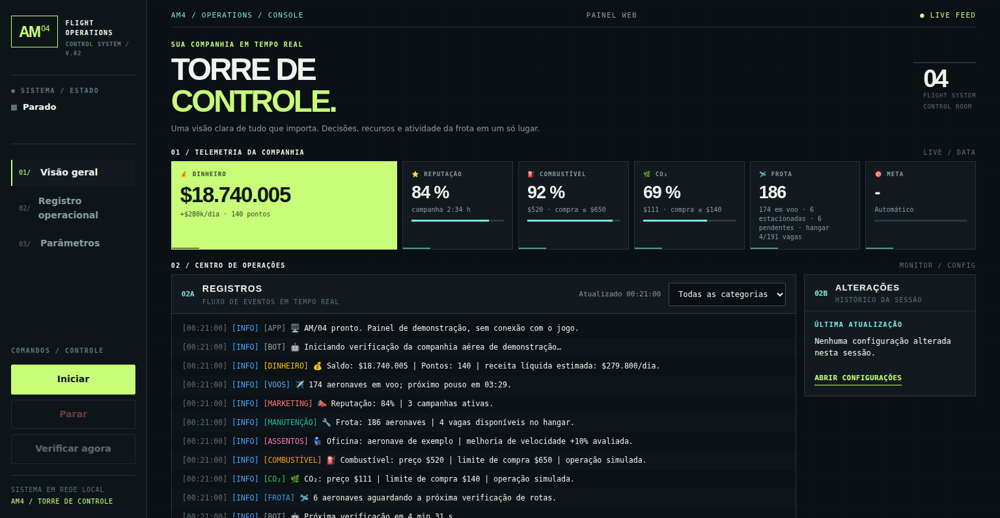

Painel compacto com indicadores da companhia, eventos do bot e confirmação da última alteração. O menu **Parâmetros** abre uma página separada; as rotinas de execução continuam na visão geral.

### Configurações em tela dedicada

| Mercado | Frota |
| --- | --- |
| 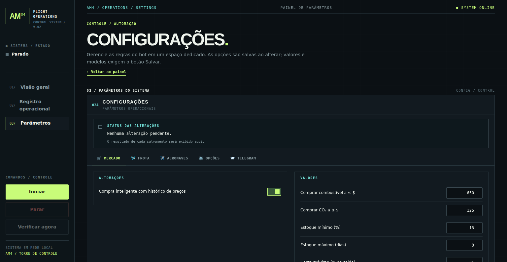 | 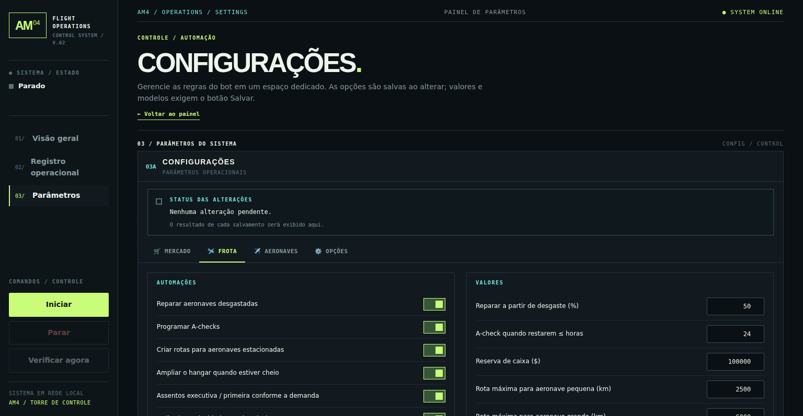 |
| Aeronaves | Opções |
| 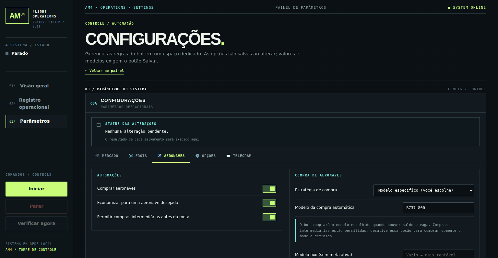 | 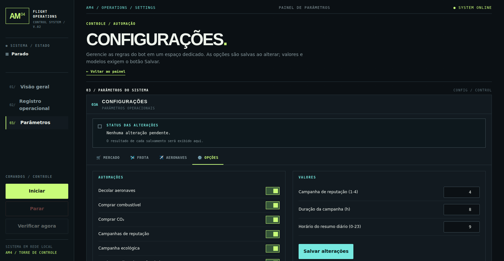 |

**Preferências individuais do Telegram:**

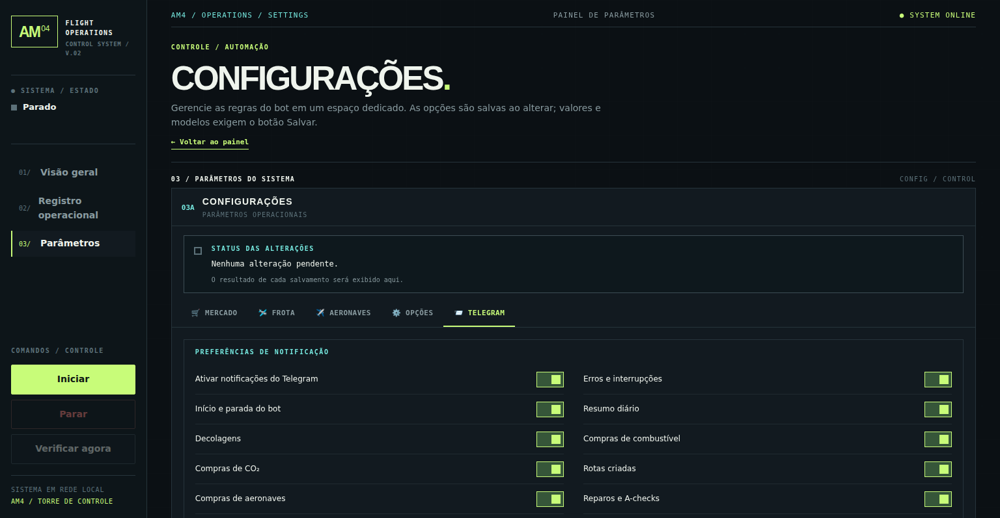

Os interruptores são salvos automaticamente e exibem confirmação; números e modelos precisam do botão **Salvar alterações**. Campos não salvos permanecem disponíveis ao trocar de categoria na sessão atual.

### Acesso pelo celular

| Visão geral | Configurações |
| --- | --- |
| 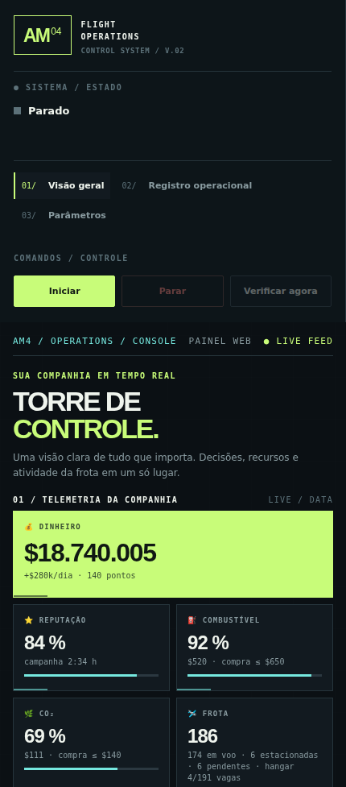 | 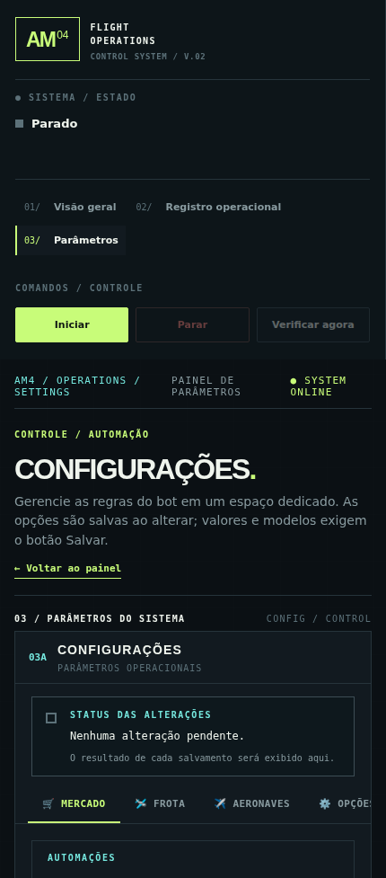 |

<b>Aplicativo desktop — abrir capturas</b>

| Mercado | Frota |
| --- | --- |
| 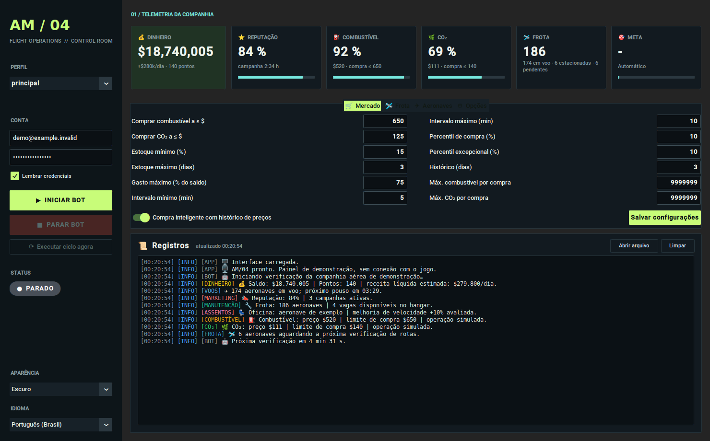 | 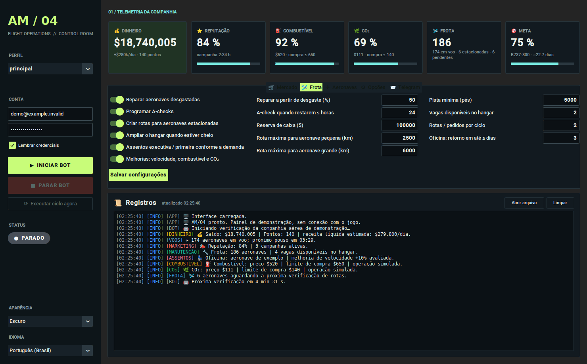 |
| Aeronaves | Opções |
| 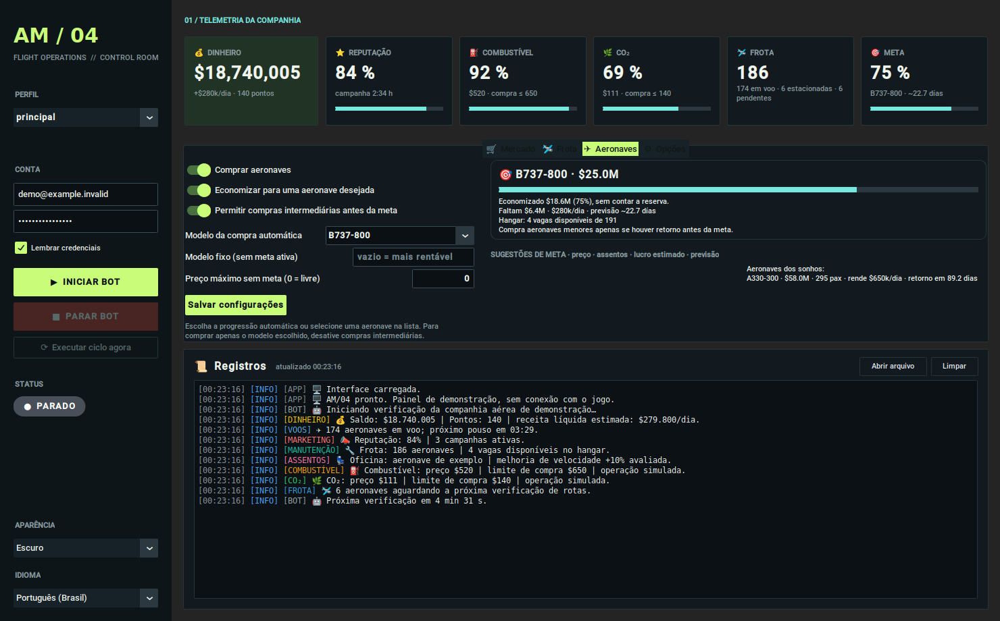 | 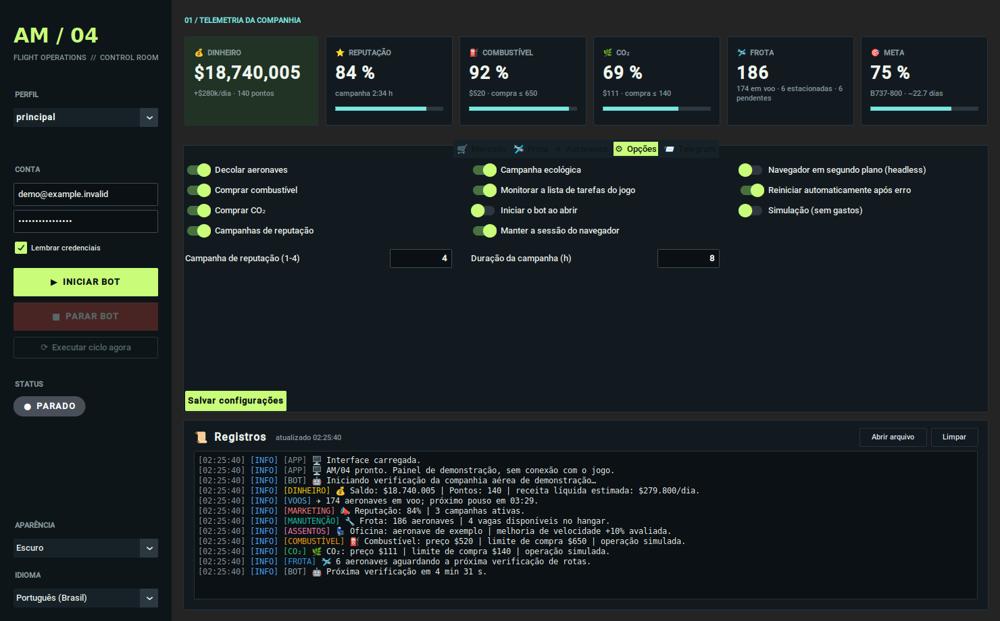 |

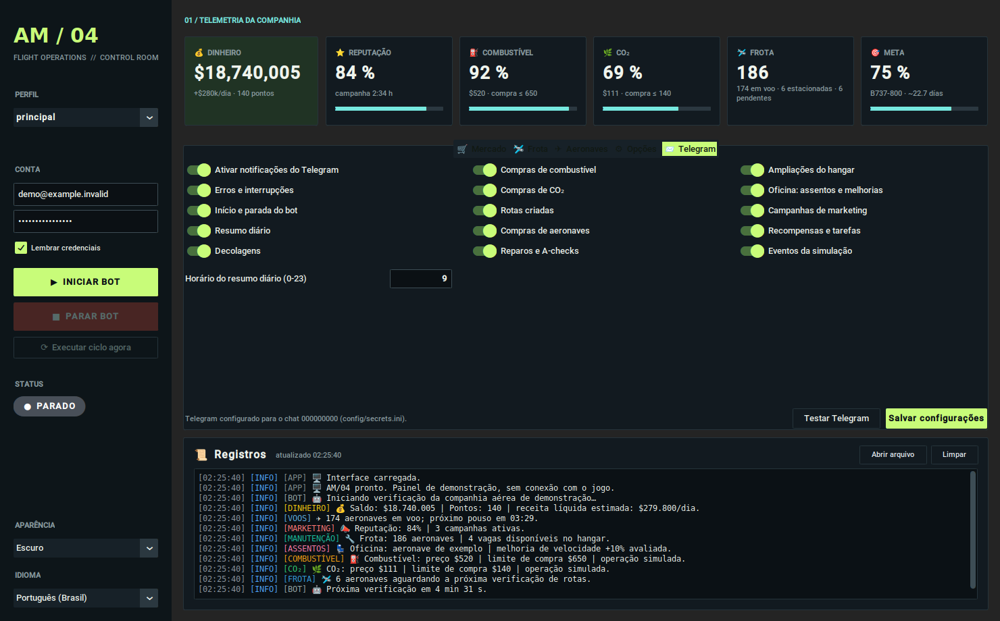

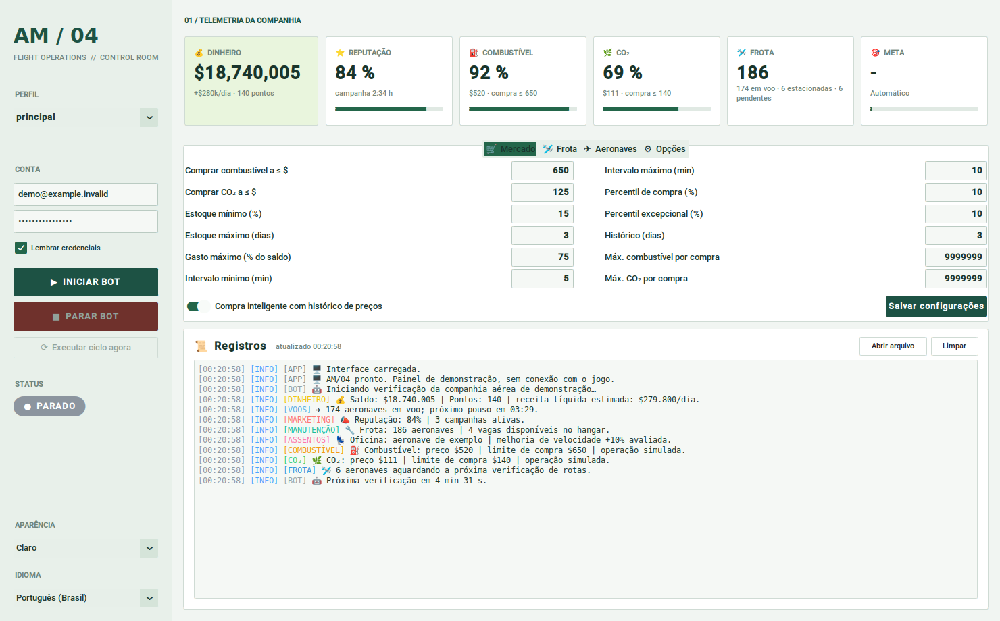

### Regenerar as capturas

O gerador [\`scripts/screenshots.py\`](scripts/screenshots.py) inicia **somente uma interface de demonstração local**, sem login no jogo, compras, decolagens ou credenciais verdadeiras. Ele captura desktop e web na resolução apropriada, e remove imagens obsoletas **apenas depois de completar todas as novas capturas**.

No Ubuntu com X11/Xvfb e Chrome instalado:

~~~bash
python -m pip install -r requirements.txt
xvfb-run -a -s "-screen 0 1920x1200x24" python scripts/screenshots.py
~~~

No Windows com ambiente gráfico, execute \`python scripts/screenshots.py\`. Para reproduzir automaticamente em uma branch no GitHub, consulte o workflow [Atualizar capturas AM/04](.github/workflows/screenshots.yml).

## Instalação fácil no Raspberry Pi OS e Ubuntu

Execute:

~~~bash
git clone https://github.com/andreypiekas/ArlineManager4BOTWEB.git
cd ArlineManager4BOTWEB
bash instalar.sh --rede-local
~~~

O instalador configura dependências, Chromium, Python, painel web e serviço systemd para inicialização automática. Use a opção **--configurar-login** para informar credenciais. Novos perfis começam em **modo simulação**.

**[Guia completo para Raspberry Pi OS e Ubuntu](docs/INSTALACAO_LINUX.md)**

## Instalação manual no Windows, Linux e macOS

Requisitos: Python 3.10 ou superior e Google Chrome ou Chromium compatível.

~~~bash
git clone https://github.com/andreypiekas/ArlineManager4BOTWEB.git
cd ArlineManager4BOTWEB
python -m venv .venv
~~~

Ative o ambiente virtual: no Windows use **.venv\Scripts\activate**; no Linux/macOS use **source .venv/bin/activate**. Depois execute:

~~~bash
pip install -r requirements.txt
python src/main.py
~~~

Informe o login do jogo, revise as opções e clique em **INICIAR BOT**. Para testar decisões sem gastos, ative **Simulação** antes de iniciar.

## Painel web e execução em segundo plano

Para executar sem a interface desktop:

~~~bash
python src/main.py --web
~~~

O painel fica disponível em **http://127.0.0.1:8744/** por padrão. Para acesso pela rede local, altere a opção de host do painel web e configure um token secreto de autenticação. Nunca exponha diretamente a porta web na internet.

Em instalações Linux, gerencie o serviço com:

~~~bash
sudo systemctl status am4bot@principal
sudo systemctl restart am4bot@principal
sudo journalctl -u am4bot@principal -f
~~~

## Perfis de diferentes companhias

Cada perfil usa credenciais, configurações, dados, sessão do navegador e porta web independentes. Use **--profile companhia2** para iniciar outro perfil. O perfil principal utiliza as pastas **config/** e **data/**; os demais ficam em **profiles/nome/**. Evite executar o mesmo perfil em dois computadores simultaneamente.

## Telegram

Crie um bot por meio do [@BotFather](https://t.me/BotFather), envie uma mensagem a ele e consulte a API **getUpdates** para obter o chat_id. Em **config/secrets.ini**, configure:

~~~ini
[telegram]
bot_token = SEU_TOKEN
chat_id = SEU_CHAT_ID
~~~

Para testar a integração, execute **python src/notify.py**. Mantenha o arquivo de segredos privado (chmod 600 no Linux).

## Guia detalhado das configurações

O bot verifica a companhia aérea periodicamente: lê o saldo, administra campanhas, repara aeronaves, ajusta assentos, decola voos disponíveis, compra combustível e CO₂, cria rotas, adquire aeronaves ou economiza para uma meta. As ações ficam registradas no painel e podem ser enviadas pelo Telegram.

Passe o mouse sobre uma configuração para abrir a ajuda contextual em português.

### Barra lateral

- **Perfis** — Cada perfil usa uma conta, configurações, dados e sessão do navegador independentes.
- **Conta** — Credenciais de acesso ao Airline Manager. Deixe em branco para fazer login manualmente no Chrome.
- **Lembrar credenciais** — Armazena as credenciais localmente em config/secrets.ini, que não é enviado ao Git.
- **Iniciar bot** — Abre o navegador e inicia os ciclos automáticos. Salve as configurações antes.
- **Parar bot** — Interrompe o bot após concluir a etapa atual e fecha o navegador.
- **Executar ciclo agora** — Executa imediatamente uma nova verificação, sem aguardar o intervalo.
- **Status** — Estado atual do bot, tempo para o próximo ciclo e informações de erro.
- **Aparência** — Escolha entre aparência clara, escura ou padrão do sistema.
- **Idioma** — Idioma da interface: português brasileiro ou inglês. A alteração do idioma do jogo depende das opções disponíveis nele.

### Indicadores

- **Dinheiro** — Saldo, renda líquida estimada por dia e pontos da companhia aérea.
- **Reputação** — Reputação e campanhas ativas, que influenciam a ocupação dos voos.
- **Combustível** — Estoque de combustível, preço por 1.000 libras e limite de compra.
- **CO₂** — Estoque de CO₂, preço por 1.000 cotas e limite de compra.
- **Frota** — Aeronaves em voo, estacionadas e pendentes de entrega ou manutenção.
- **Meta** — Progresso financeiro e prazo estimado para adquirir a aeronave desejada.

### Aba Mercado

- **Comprar combustível a ≤ $** — Compra combustível neste preço ou abaixo, mesmo que o histórico indique esperar.
- **Comprar CO₂ a ≤ $** — Compra CO₂ neste preço ou abaixo, mesmo que o histórico indique esperar.
- **Estoque mínimo (%)** — Abaixo deste nível, repõe os insumos mesmo que o preço esteja alto.
- **Estoque máximo (dias)** — Limita o estoque à previsão de consumo por dias. Zero permite encher completamente.
- **Gasto máximo (% do saldo)** — Percentual máximo do saldo disponível acima da reserva por compra.
- **Intervalo mínimo (min)** — Tempo mínimo entre verificações automáticas.
- **Intervalo máximo (min)** — Tempo máximo entre verificações; pousos e preços podem antecipar o ciclo.
- **Percentil de compra (%)** — Compra nos percentis de preços mais baixos dos últimos dias.
- **Percentil excepcional (%)** — Preço excepcional pode liberar compras maiores e repetidas na mesma meia hora. Zero desativa.
- **Histórico (dias)** — Quantidade de dias usada na análise do histórico de preços.
- **Máx. combustível por compra** — Quantidade máxima de combustível por compra. 9.999.999 libera o limite do tanque.
- **Máx. CO₂ por compra** — Quantidade máxima de CO₂ por compra. 9.999.999 libera o limite do tanque.
- **Compra inteligente com histórico de preços** — Compra segundo os preços mais vantajosos do histórico.

### Aba Frota

- **Reparar a partir de desgaste (%)** — Desgaste percentual a partir do qual deve reparar uma aeronave.
- **A-check quando restarem ≤ horas** — Horas restantes para iniciar a programação do A-check.
- **Reserva de caixa ($)** — Valor protegido contra compras não essenciais, preservando a operação.
- **Rota máxima para aeronave pequena (km)** — Distância máxima de rotas para aeronaves pequenas e médias.
- **Rota máxima para aeronave grande (km)** — Distância máxima de rotas para aeronaves de grande porte.
- **Pista mínima (pés)** — Comprimento mínimo da pista do aeroporto de destino.
- **Vagas disponíveis no hangar** — Quantidade de vagas que o bot tenta manter livres no hangar.
- **Rotas / pedidos por ciclo** — Limita novas rotas e pedidos de aeronaves por ciclo.
- **Oficina: retorno em até ≤ dias** — Prazo máximo para recuperar o custo de melhorias e perda de receita durante a parada.
- **Reparar aeronaves desgastadas** — Programa reparos das aeronaves que atingirem o desgaste definido.
- **Programar revisões A-check** — Programa o A-check quando restarem poucas horas.
- **Criar rotas para aeronaves estacionadas** — Cria rotas com demanda adequada para aeronaves estacionadas.
- **Ampliar o hangar quando estiver cheio** — Compra expansão do hangar quando estiver perto do limite.
- **Assentos executiva / primeira conforme a demanda** — Distribui assentos entre econômica, executiva e primeira classe conforme a demanda.
- **Melhorias: velocidade, combustível e CO₂** — Avalia melhorias de velocidade, consumo de combustível e emissões de CO₂.

### Aba Aeronaves

A compra automática oferece duas estratégias quando **Economizar para uma aeronave desejada** está ativado:

1. **Progressão automática (bot escolhe):** seleciona a próxima aeronave conforme orçamento, lucratividade prevista e prazo de retorno.
2. **Modelo específico (você escolhe):** abre uma lista com os modelos que o bot leu do mercado do jogo. Escolha ou digite o modelo, clique em **Salvar alterações** e o bot aguardará saldo suficiente e vaga no hangar para comprá-lo.

**Importante:** a opção **Permitir compras intermediárias antes da meta** permite que o bot compre outras aeronaves enquanto economiza para o modelo selecionado. **Desative-a se deseja comprar somente o modelo escolhido.** A seleção respeita a reserva de caixa e não faz compras quando a frota exige tratamento de rotas.

- **Comprar aeronaves** — Ativa ou desativa a automação de aquisição de aeronaves.
- **Economizar para uma aeronave desejada** — Ativa a estratégia de progressão ou de modelo específico; sem ela, o bot ignora a meta.
- **Permitir compras intermediárias antes da meta** — Permite aquisições complementares somente quando antecipam a meta.
- **Modelo da compra automática** — Progressão automática ou aeronave específica escolhida na lista do mercado; salva em `goal_model`.
- **Modelo fixo (sem meta ativa)** — Usado somente quando **Economizar para uma aeronave desejada** está desativado. Vazio significa comprar a aeronave mais rentável disponível.

**Motor da aeronave — nova configuração:** fica na mesma aba **Aeronaves** e vale tanto para a progressão automática quanto para compras de modelo específico.

- **Padrão do jogo:** preserva a escolha de motorização feita pelo jogo (comportamento anterior).
- **Mais rápido:** seleciona a opção com maior velocidade **somente se o formulário fornecer velocidades comparáveis**.
- **Menor consumo:** seleciona a opção de menor consumo **somente se o formulário fornecer dados comparáveis**.
- **Motor específico:** informe um nome que apareça na opção de compra, por exemplo `Trent 972`. A correspondência deve ser única.

**Segurança:** o bot inspeciona as opções de motor na janela real de aquisição antes de clicar em **Comprar**. Se a página não apresentar um seletor nativo identificável, se houver ambiguidade ou se a seleção não for confirmada pelo formulário, **não realiza o pedido**. Isso é especialmente importante para aeronaves caras. O recurso não contorna CAPTCHA e não troca motores de aeronaves já adquiridas. Como não há um HTML autenticado do jogo incluído neste repositório, a compatibilidade da seleção automática com a página real ainda precisa ser validada no servidor; os testes atuais usam formulários simulados.

- **Preço máximo sem meta (0 = livre)** — Limite aplicável à estratégia sem meta; zero remove o limite.

A lista de modelos é preenchida após o bot consultar o mercado. Caso esteja vazia, é possível digitar o nome manualmente; o bot só efetuará o pedido quando conseguir localizar o modelo.

### Aba Opções

- **Campanha de reputação (1-4)** — Nível da campanha de reputação entre 1 e 4.
- **Duração da campanha (h)** — Duração das campanhas: 4, 8, 12, 16, 20 ou 24 horas.
- **Decolar aeronaves** — Decola as aeronaves disponíveis em cada ciclo.
- **Comprar combustível** — Compra combustível conforme os critérios da aba Mercado.
- **Comprar CO₂** — Compra CO₂ conforme os critérios da aba Mercado.
- **Campanhas de reputação** — Inicia campanhas de reputação se o retorno justificar o custo.
- **Campanha ecológica** — Mantém campanha ecológica enquanto for vantajosa e houver CO₂.
- **Monitorar a lista de tarefas do jogo** — Monitora tarefas e coleta recompensas disponíveis no jogo.
- **Iniciar o bot ao abrir** — Inicia automaticamente o bot ao abrir o aplicativo.
- **Manter a sessão do navegador** — Mantém os cookies e os dados da sessão do Chrome.
- **Navegador em segundo plano (headless)** — Executa o navegador oculto; CAPTCHAs ainda exigem intervenção manual.
- **Reiniciar automaticamente após erro** — Reinicia automaticamente após falhas, com intervalo crescente.
- **Simulação (sem gastos)** — Simula ações sem executar compras ou mudanças no jogo.

### Aba Telegram — escolha exatamente quais alertas receber

No painel web, abra **Parâmetros → Telegram**. No desktop, use a aba **Telegram**. Cada opção é independente e os interruptores são salvos automaticamente, sem reiniciar o bot:

- **Chave geral** — Liga/desliga todos os envios. Ao religar, as preferências individuais são preservadas.
- **Erros e interrupções** — Falhas operacionais e encerramentos inesperados; recomendado manter ligado.
- **Início e parada** — Mensagens quando o bot inicia ou para normalmente.
- **Resumo diário** — Saldo, estoques, frota, compras e resultado do dia; ajuste o horário de envio no mesmo painel.
- **Decolagens** — Avisos de partidas.
- **Compras de combustível e de CO₂** — Duas opções independentes, para receber somente os abastecimentos desejados.
- **Rotas criadas e aeronaves encomendadas** — Avisos de expansão da malha e da frota.
- **Reparos/A-checks, ampliação de hangar e oficina** — Três categorias distintas.
- **Campanhas de marketing e tarefas** — Notificações de campanhas, atividades e recompensas.
- **Simulação** — Avisos de ações simuladas (sem compras reais).

A aba inclui um **teste de envio**, que pode ser usado mesmo com filtros desligados, para confirmar a comunicação com o Telegram. A configuração usa o token e o chat ID mantidos exclusivamente em `config/secrets.ini`; o painel não exibe esses segredos.

Os filtros **não impedem decolagens, compras nem outras operações**, e não eliminam mensagens do log local. Eles apenas decidem quais eventos serão enviados ao Telegram. Todos os tipos permanecem habilitados por padrão após a atualização para preservar o comportamento anterior; personalize os interruptores conforme sua necessidade.

### Registros e notificações

- **Registros** — O bot informa compras, partidas, rotas, manutenção, erros e tarefas executadas. O painel web e o aplicativo mostram os mesmos eventos.
- **Telegram** — Configure a seção `[telegram]` em `config/secrets.ini`. Em **Parâmetros → Telegram** selecione individualmente os avisos que deseja receber.
- **Modo simulação** — Ative para verificar as decisões sem fazer compras nem modificar a companhia aérea.

### Painel web e operação contínua

Execute `python src/main.py --web` para iniciar somente o painel web. O endereço padrão é `http://127.0.0.1:8744/`. Para acesso pela rede local, utilize token de autenticação. Os scripts da pasta `scripts/` ajudam na execução no Windows e no Raspberry Pi.

### Segurança e compatibilidade

Mantenha `config/secrets.ini` privado e não faça commit de credenciais. O idioma do aplicativo é português brasileiro por padrão, com inglês opcional. O bot somente seleciona português dentro do jogo se esse idioma existir nas opções da conta; caso contrário, preserva o idioma atual do jogo.

## Arquivos de configuração

- **config/defaults.ini**: configurações padrão e seletores de elementos do jogo, versionados no Git.
- **config/settings.ini**: configurações específicas do perfil principal; ignorado pelo Git.
- **config/secrets.ini**: credenciais do jogo, token do painel web e Telegram; mantenha privado.
- **profiles/nome/**: configuração e dados dos perfis adicionais.
- **data/prices.json**: histórico de preços; **data/market.json**: mercado de aeronaves; **data/state.json**: estado e contadores do bot.
- **data/logs/am4bot.log**: registro de execução.

As seções de configuração são **[settings]** (valores numéricos), **[options]** (botões de ativação), **[web]** (rede e porta), **[app]** (aparência e idioma pt_BR ou en) e **[selectors]** (seletores do jogo, definidos apenas no arquivo de padrões).

## Observações

- O jogo pode modificar a estrutura das páginas; a automação Selenium depende desses elementos.
- Se surgir CAPTCHA, faça a verificação manualmente; o bot não contorna mecanismos de segurança.
- As estimativas de lucro não garantem resultados.
- A automação pode ser restrita pelos termos do jogo; confira as regras antes de utilizá-la.
- O projeto usa a licença MIT. O aviso de copyright obrigatório está preservado no arquivo [LICENSE](LICENSE).
