

  <h1>AM / 04 · TORRE DE CONTROLE</h1>
  
<strong>AirlineManager4BOTWEB</strong>

  
Automação para o <a href="https://www.airlinemanager.com">Airline Manager 4</a> com painel desktop e web: decolagens, combustível, CO₂, manutenção, campanhas de marketing, rotas e compra de aeronaves.

**Idioma padrão: Português (Brasil).** Inglês disponível como alternativa.

## Instalação fácil no Raspberry Pi OS e Ubuntu

No terminal do servidor, execute como usuário normal com acesso a `sudo`:

~~~bash
curl -fsSLo instalar-am4.sh https://raw.githubusercontent.com/andreypiekas/AirlineManager4BOTWEB/main/instalar.sh && bash instalar-am4.sh --rede-local
~~~

1. Informe o login do jogo quando solicitado. A senha fica oculta. Para pular, pressione **Enter** no campo de e-mail.
2. Abra no navegador o endereço completo que aparece no terminal. Com `--rede-local`, o link inclui um token para acesso pela rede local.
3. Revise **Parâmetros → Opções**. O instalador ativa **Simulação (sem gastos)** para perfis novos. Se você pulou o login, siga a seção de primeiro acesso do guia Linux para cadastrar as credenciais.

O instalador prepara Python, Chromium e o serviço `am4bot@principal`, que abre o painel após reiniciar o servidor. Se faltar o `curl`, instale com `sudo apt-get install curl`.

Para atualizar, entre na pasta indicada pelo instalador (normalmente `~/AirlineManager4Bot`) e rode `git pull --ff-only && bash instalar.sh`.

**[Guia Linux com opções, atualização e solução de problemas](docs/INSTALACAO_LINUX.md)**

## Instalação no Windows

1. Instale [Python 3.10 ou superior](https://www.python.org/downloads/windows/) e Google Chrome ou Chromium.
2. [Baixe o ZIP](https://github.com/andreypiekas/AirlineManager4BOTWEB/archive/refs/heads/main.zip) e extraia todos os arquivos.
3. Dê dois cliques em `instalar.bat` e, ao terminar, em `iniciar.bat`.
4. Em **Conta**, informe o login do jogo. Ative **Simulação (sem gastos)** nas opções para testar e clique em **Iniciar bot**.

Para usar o painel web, mantenha **Lembrar credenciais** marcado no primeiro acesso e use `scripts\web.bat`. O endereço padrão do painel local é `http://127.0.0.1:8744/`.

Instalação manual no Linux ou macOS

Com Python 3.10+, Tkinter e Chrome ou Chromium instalados:

~~~bash
git clone https://github.com/andreypiekas/AirlineManager4BOTWEB.git
cd AirlineManager4BOTWEB
python3 -m venv .venv
.venv/bin/python -m pip install -r requirements.txt
.venv/bin/python src/main.py
~~~

Configure o login na interface desktop e ative **Simulação (sem gastos)** antes de iniciar os testes. Para usar o painel web depois, marque **Lembrar credenciais** e execute `.venv/bin/python src/main.py --web`.

## Funcionalidades

- Decola aeronaves prontas e verifica os voos.
- Compra combustível e CO₂ usando histórico de preços, níveis mínimos e limites de saldo.
- Programa reparos e revisões A-check, e amplia vagas do hangar quando necessário.
- Cria rotas diretas ou com escala quando viável, analisa duplicidades e pode trocar rotas repetidas.
- Avalia assentos e melhorias das aeronaves conforme a demanda e o custo.
- Planeja novas aquisições com estimativas de rentabilidade e metas de crescimento.
- Gerencia campanhas de reputação e ecológicas segundo o retorno estimado.
- Acompanha tarefas do jogo e coleta recompensas disponíveis.
- Exibe os dados da companhia, o histórico de operações e as configurações em painel desktop e web.
- Envia notificações pelo Telegram e tenta reiniciar após falhas.
- Oferece **Simulação (sem gastos)** para avaliar decisões antes de executá-las.

As estimativas adaptam-se aos modos Fácil e Realista e dependem das informações disponíveis da companhia.

## Controle de rotas e duplicidades

Em **Rotas e aeronaves**, o painel web lista as aeronaves já identificadas por
perfil, com lucro diário estimado, duplicidades, propostas de troca e histórico.
O cadastro acumula leituras ao longo dos ciclos, inclusive quando o jogo exibe
só parte da frota. Uma correção manual nessa tela atualiza apenas o relatório.
O controle trata `DUB → GRU` e `GRU → DUB` como a mesma rota.

### Trocar uma rota repetida

1. Em **Parâmetros → Frota**, mantenha **Permitir aeronaves na mesma rota (ida/volta)** desligado e **Analisar e sugerir correções de rotas repetidas** ligado. Esses são os padrões.
2. Confira as alternativas em **Rotas e aeronaves**. O campo **Ajuste de rota: lucro mínimo adicional (%)** controla o ganho exigido quando há uma estimativa confiável da rota atual.
3. Para autorizar alterações no jogo, ligue **Substituir rotas repetidas automaticamente** (desligado por padrão) e desligue **Simulação (sem gastos)** em **Parâmetros → Opções**.

O bot faz no máximo uma tentativa real de troca por ciclo. Ele confirma no jogo
a aeronave pousada, o aeroporto atual e o vínculo da rota. A taxa precisa caber
no saldo disponível acima da reserva de caixa. A rota alternativa mantém uma
base adquirida em uma das pontas para permitir manutenção e A-check na ida ou
na volta. Se a aeronave estiver pousada fora de uma base própria, a alternativa
precisa levá-la a uma base adquirida.

A troca automática se aplica a rotas diretas. Quando o resultado de uma troca
fica pendente de confirmação, as decolagens automáticas aguardam a verificação.

### Criar rotas para aeronaves sem rota

Ative **Criar rotas para aeronaves estacionadas** em **Parâmetros → Frota**.
O bot pode tentar uma escala (*stopover*) quando identifica a aeronave
estacionada em uma base adquirida e conhece seu modelo e alcance. A busca por
escala entra em ação quando o limite de distância configurado excede o alcance
direto. O bot verifica as pistas, a autonomia em cada trecho e a distância
total dentro do limite configurado. Se a pesquisa não encontrar uma escala
adequada, o bot tenta rotas diretas. Se o pedido de criação com escala já foi
enviado e ainda aguarda confirmação, o bot volta a conferir a aeronave na
próxima leitura da frota.

A opção avançada `route_stopover` vem ligada na seção `[options]` do
`settings.ini` do perfil. Com ela ligada, uma aeronave sem rota identificada
fora das bases adquiridas fica para revisão.

### Política de decolagens

Em **Parâmetros → Opções**, **Decolar aeronaves** controla as partidas.
**Bloquear decolagens com rotas duplicadas** vem desligado. Para reter esses
voos, ligue o bloqueio e mantenha **Despacho individual seguro quando houver
rotas duplicadas** ligado. Com duplicidades conhecidas, o bot usa os comandos
individuais que conseguir confirmar no jogo. Se o despacho individual estiver
desligado, o bot retém todas as partidas enquanto houver duplicidades
conhecidas. A tela **Rotas e aeronaves** mostra as aeronaves aprovadas, as
retidas e as partidas confirmadas.

[Guia de controle de rotas e decolagens](docs/CONTROLE_ROTAS.md)

## Hubs e Aeronaves — roadmap em execução

O painel web já possui a primeira tela **Hubs e Aeronaves** e o endpoint
autenticado `GET /api/hubs`. O inventário das bases é coletado quando a
pesquisa de rotas do bot abre o seletor de hubs do jogo. A tela separa dados
verificados de aeronaves cuja base de origem ainda não foi comprovada.
Não há compras ou remanejamentos automáticos neste módulo.

A associação individual da frota, a apuração de lucro por base e os rankings
de expansão **ainda aguardam validação de fontes no jogo**.

[Roadmap detalhado](docs/ROADMAP_HUBS_AERONAVES.md) ·
[Histórico das entregas e testes](docs/HISTORICO_IMPLEMENTACOES.md).

## Interface — AM/04 Torre de Controle

As capturas foram geradas pelo aplicativo com uma companhia de demonstração.
O painel web usa tema escuro e se adapta ao celular. O desktop também oferece
tema claro.

[Guia da interface](docs/IDENTIDADE_VISUAL.md)

### Painel operacional

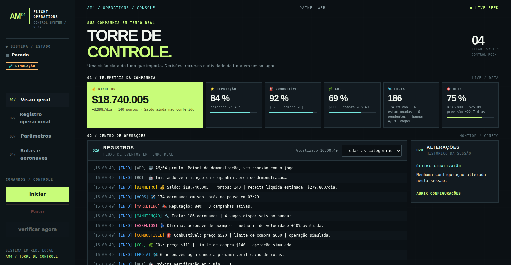

### Rotas e aeronaves

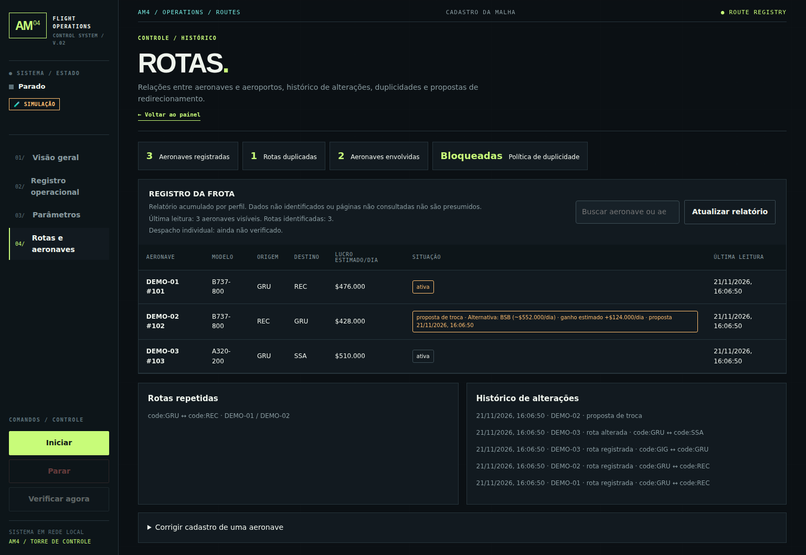

### Configurações em tela dedicada

| Mercado | Frota |
| --- | --- |
| 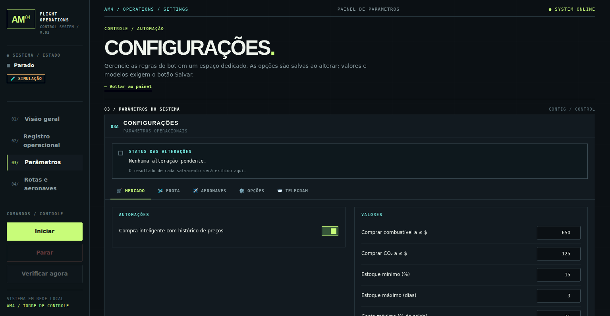 | 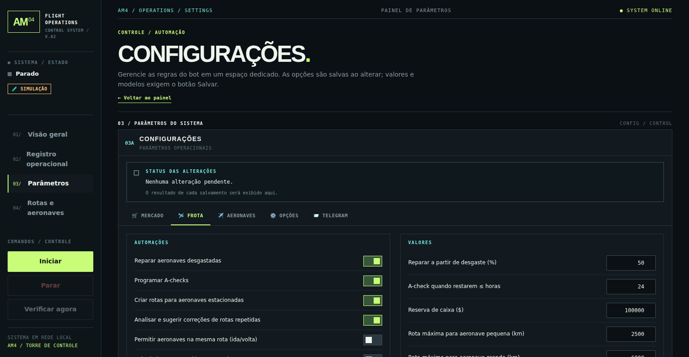 |
| Aeronaves | Opções |
| 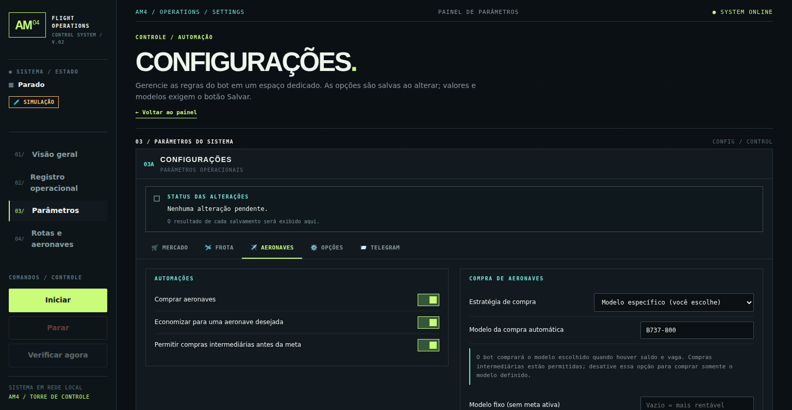 | 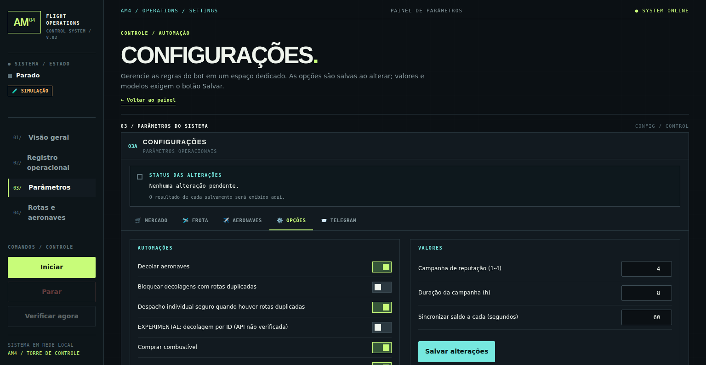 |

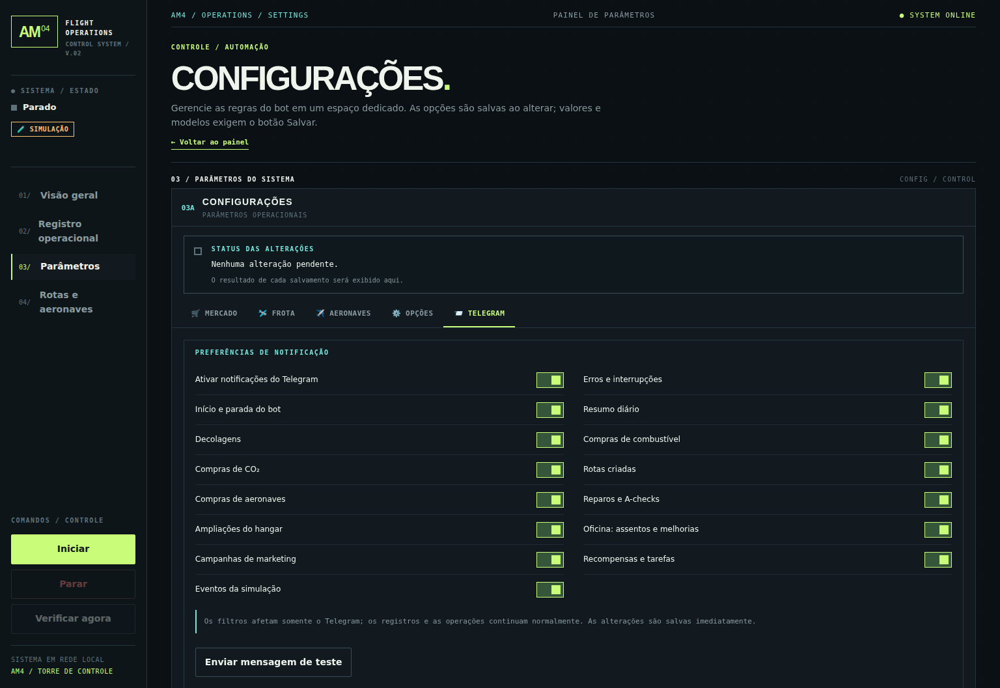

No painel web, abra **Parâmetros** no menu lateral. Os interruptores são salvos
ao clicar. Para gravar números e modelos, use **Salvar alterações**. Os campos
em edição permanecem disponíveis ao trocar de categoria na sessão atual.

### Acesso pelo celular

| Visão geral | Configurações |
| --- | --- |
| 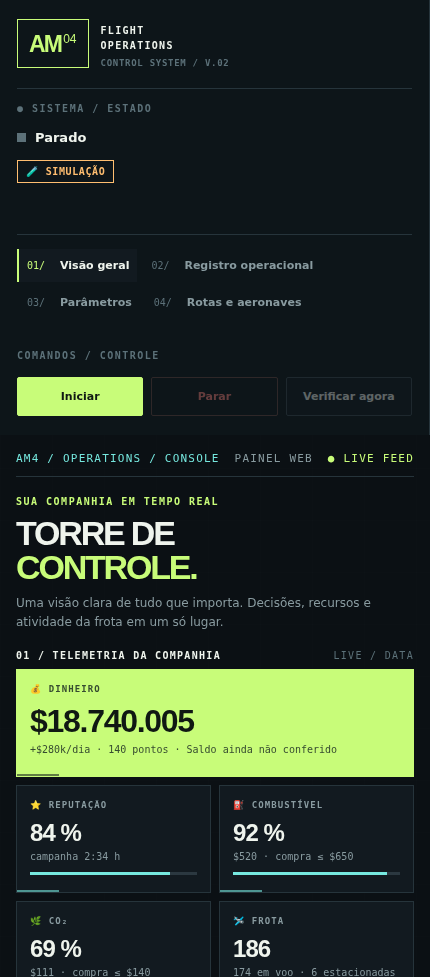 | 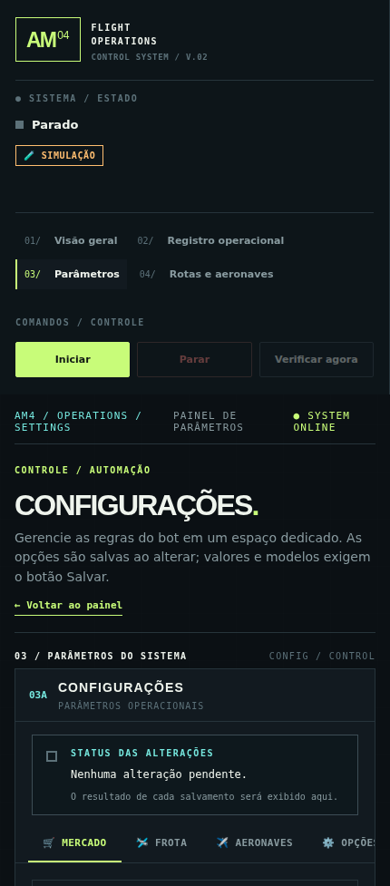 |

<b>Aplicativo desktop — abrir capturas</b>

| Mercado | Frota |
| --- | --- |
| 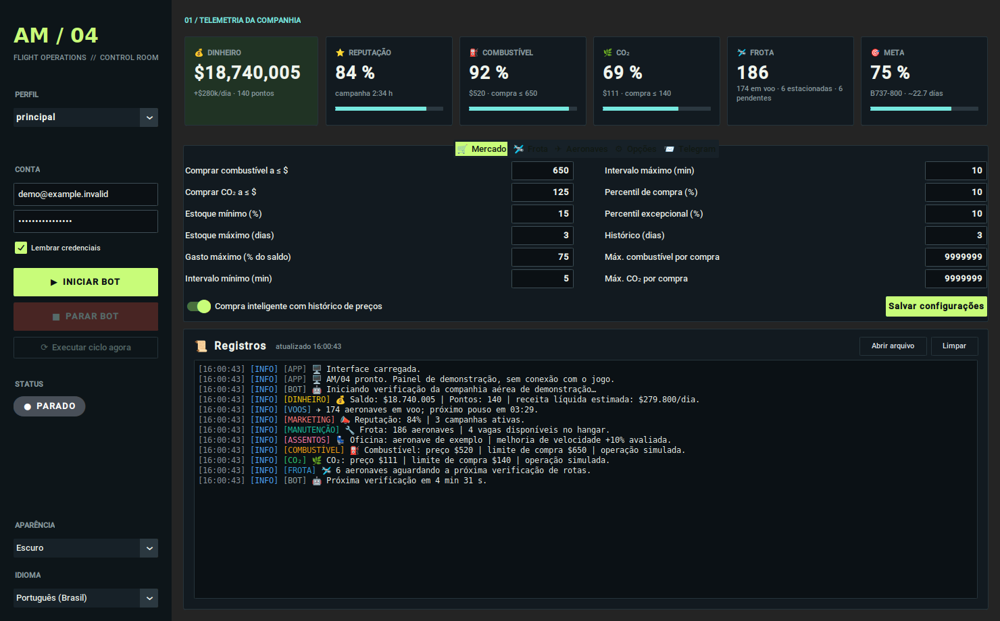 | 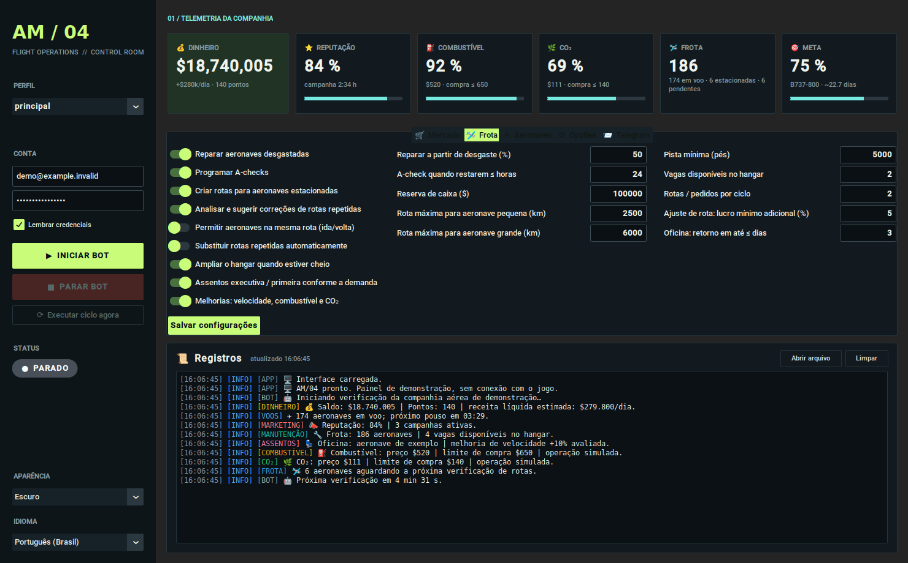 |
| Aeronaves | Opções |
| 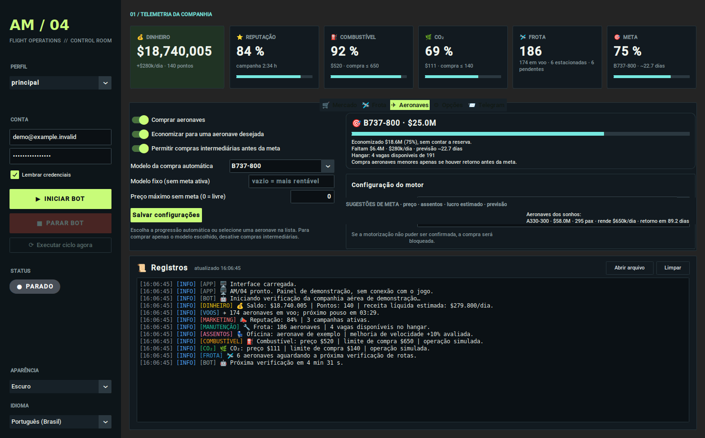 | 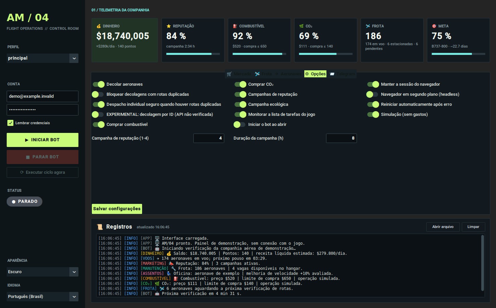 |

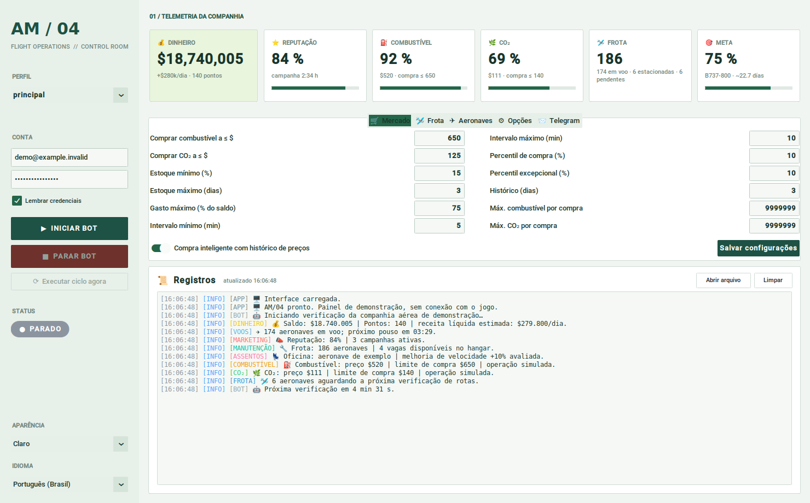

### Regenerar as capturas

O gerador [`scripts/screenshots.py`](scripts/screenshots.py) abre as interfaces
desktop e web com dados fictícios em uma pasta temporária. Ele usa um painel
local e atualiza `screenshots/` depois que todas as capturas forem geradas.

No Ubuntu com Tkinter, Xvfb, xauth e Chrome instalados, use o ambiente virtual
do projeto:

~~~bash
.venv/bin/python -m pip install -r requirements.txt
xvfb-run -a -s "-screen 0 1920x1200x24" .venv/bin/python scripts/screenshots.py
~~~

No Windows com ambiente gráfico, execute `.venv\Scripts\python.exe scripts\screenshots.py`.
No GitHub, execute o workflow [Atualizar capturas AM/04](.github/workflows/screenshots.yml)
em uma branch de documentação.

## Perfis de diferentes companhias

Cada perfil tem configurações, credenciais, dados, sessão do navegador e porta
web próprios. Para adicionar uma companhia no desktop, use **Perfis** na
barra lateral ou inicie o aplicativo com `--profile companhia2`. No
instalador Linux, use `bash instalar.sh --rede-local --perfil companhia2`.
Cadastre o login do jogo no novo perfil antes de iniciar o bot.

| Arquivos | Perfil principal | Demais perfis |
| --- | --- | --- |
| Preferências | `config/settings.ini` | `profiles/<nome>/settings.ini` |
| Segredos | `config/secrets.ini` | `profiles/<nome>/secrets.ini` |
| Sessão do navegador | `config/session/` | `profiles/<nome>/session/` |
| Dados e registros | `data/` | `profiles/<nome>/data/` |

Na criação de um perfil, as configurações do Telegram podem ser copiadas do
perfil de origem. Confira o token e o chat de destino antes de iniciar o bot.

## Telegram

Crie um bot por meio do [@BotFather](https://t.me/BotFather), envie uma
mensagem a ele e consulte o método `getUpdates` da API para obter o
`chat_id`. Configure a seção abaixo em `config/secrets.ini` para o perfil
principal ou em `profiles/<nome>/secrets.ini` para os demais perfis.

~~~ini
[telegram]
bot_token = SEU_TOKEN
chat_id = SEU_CHAT_ID
~~~

No painel web, abra **Parâmetros → Telegram → Enviar mensagem de teste**. No
desktop, use **Telegram → Testar Telegram**. O teste funciona mesmo com
os filtros desligados. Se alterar o token ou o chat com o bot em
execução, reinicie o bot para aplicar os dados aos avisos automáticos.

## Guia detalhado das configurações

O bot verifica a companhia aérea periodicamente: lê o saldo, administra campanhas, repara aeronaves, ajusta assentos, decola voos disponíveis, compra combustível e CO₂, cria rotas, adquire aeronaves ou economiza para uma meta. As ações ficam registradas no painel e podem ser enviadas pelo Telegram.

Passe o mouse sobre uma configuração para abrir a ajuda contextual em português.

### Barra lateral

- **Perfis** — Cada perfil usa uma conta, configurações, dados e sessão do navegador independentes.
- **Conta** — Credenciais de acesso ao Airline Manager. Deixe em branco para fazer login manualmente no Chrome.
- **Lembrar credenciais** — Armazena as credenciais no `secrets.ini` do perfil.
- **Iniciar bot** — Abre o navegador e inicia os ciclos automáticos. Salve as configurações antes.
- **Parar bot** — Interrompe o bot após concluir a etapa atual e fecha o navegador.
- **Executar ciclo agora** — Executa imediatamente uma nova verificação, sem aguardar o intervalo.
- **Status** — Estado atual do bot, tempo para o próximo ciclo e informações de erro.
- **Aparência** — Escolha entre aparência clara, escura ou padrão do sistema.
- **Idioma** — Idioma da interface: português brasileiro ou inglês. A alteração do idioma do jogo depende das opções disponíveis nele.

### Indicadores

- **Dinheiro** — Saldo, renda líquida estimada por dia e pontos da companhia aérea.
- **Reputação** — Reputação e campanhas ativas, que influenciam a ocupação dos voos.
- **Combustível** — Estoque de combustível, preço por 1.000 libras e limite de compra.
- **CO₂** — Estoque de CO₂, preço por 1.000 cotas e limite de compra.
- **Frota** — Aeronaves em voo, estacionadas e pendentes de entrega ou manutenção.
- **Meta** — Progresso financeiro e prazo estimado para adquirir a aeronave desejada.

### Aba Mercado

- **Comprar combustível a ≤ $** — Compra combustível neste preço ou abaixo, mesmo que o histórico indique esperar.
- **Comprar CO₂ a ≤ $** — Compra CO₂ neste preço ou abaixo, mesmo que o histórico indique esperar.
- **Estoque mínimo (%)** — Abaixo deste nível, repõe os insumos mesmo que o preço esteja alto.
- **Estoque máximo (dias)** — Limita o estoque à previsão de consumo por dias. Zero permite encher completamente.
- **Gasto máximo (% do saldo)** — Percentual máximo do saldo disponível acima da reserva por compra.
- **Intervalo mínimo (min)** — Tempo mínimo entre verificações automáticas.
- **Intervalo máximo (min)** — Tempo máximo entre verificações; pousos e preços podem antecipar o ciclo.
- **Percentil de compra (%)** — Compra nos percentis de preços mais baixos dos últimos dias.
- **Percentil excepcional (%)** — Preço excepcional pode liberar compras maiores e repetidas na mesma meia hora. Zero desativa.
- **Histórico (dias)** — Quantidade de dias usada na análise do histórico de preços.
- **Máx. combustível por compra** — Quantidade máxima de combustível por compra. 9.999.999 libera o limite do tanque.
- **Máx. CO₂ por compra** — Quantidade máxima de CO₂ por compra. 9.999.999 libera o limite do tanque.
- **Compra inteligente com histórico de preços** — Compra segundo os preços mais vantajosos do histórico.

### Aba Frota

- **Reparar a partir de desgaste (%)** — Desgaste percentual a partir do qual deve reparar uma aeronave.
- **A-check quando restarem ≤ horas** — Horas restantes para iniciar a programação do A-check.
- **Reserva de caixa ($)** — Valor protegido contra compras não essenciais, preservando a operação.
- **Rota máxima para aeronave pequena (km)** — Distância máxima de rotas para aeronaves pequenas e médias.
- **Rota máxima para aeronave grande (km)** — Distância máxima de rotas para aeronaves de grande porte.
- **Pista mínima (pés)** — Comprimento mínimo da pista do aeroporto de destino.
- **Vagas disponíveis no hangar** — Quantidade de vagas que o bot tenta manter livres no hangar.
- **Rotas / pedidos por ciclo** — Limita novas rotas e pedidos de aeronaves por ciclo.
- **Oficina: retorno em até ≤ dias** — Prazo máximo para recuperar o custo de melhorias e perda de receita durante a parada.
- **Reparar aeronaves desgastadas** — Programa reparos das aeronaves que atingirem o desgaste definido.
- **Programar A-checks** — Programa a revisão quando restarem poucas horas.
- **Criar rotas para aeronaves estacionadas** — Cria rotas para aeronaves estacionadas que ainda estão sem rota.
- **Ampliar o hangar quando estiver cheio** — Compra expansão do hangar quando estiver perto do limite.
- **Assentos executiva / primeira conforme a demanda** — Distribui assentos entre econômica, executiva e primeira classe conforme a demanda.
- **Melhorias: velocidade, combustível e CO₂** — Avalia melhorias de velocidade, consumo de combustível e emissões de CO₂.

### Aba Aeronaves

A compra automática oferece duas estratégias quando **Economizar para uma aeronave desejada** está ativado:

1. **Progressão automática (bot escolhe):** seleciona a próxima aeronave conforme orçamento, lucratividade prevista e prazo de retorno.
2. **Modelo específico (você escolhe):** abre uma lista com os modelos que o bot leu do mercado do jogo. Escolha ou digite o modelo, clique em **Salvar alterações** e o bot aguardará saldo suficiente e vaga no hangar para comprá-lo.

**Importante:** a opção **Permitir compras intermediárias antes da meta** permite que o bot compre outras aeronaves enquanto economiza para o modelo selecionado. **Desative-a se deseja comprar somente o modelo escolhido.** A seleção respeita a reserva de caixa e não faz compras quando a frota exige tratamento de rotas.

- **Comprar aeronaves** — Ativa ou desativa a automação de aquisição de aeronaves.
- **Economizar para uma aeronave desejada** — Ativa a estratégia de progressão ou de modelo específico; sem ela, o bot ignora a meta.
- **Permitir compras intermediárias antes da meta** — Permite aquisições complementares somente quando antecipam a meta.
- **Modelo da compra automática** — Progressão automática ou aeronave específica escolhida na lista do mercado; salva em `goal_model`.
- **Modelo fixo (sem meta ativa)** — Usado somente quando **Economizar para uma aeronave desejada** está desativado. Vazio significa comprar a aeronave mais rentável disponível.

**Motorização da aeronave**, na aba **Aeronaves**, vale para progressão automática e compras de modelo específico.

- **Padrão do jogo:** preserva a escolha de motorização feita pelo jogo (comportamento anterior).
- **Mais rápido:** seleciona a opção com maior velocidade **somente se o formulário fornecer velocidades comparáveis**.
- **Menor consumo:** seleciona a opção de menor consumo **somente se o formulário fornecer dados comparáveis**.
- **Motor específico:** informe um nome que apareça na opção de compra, por exemplo `Trent 972`. A correspondência deve ser única.

Ao escolher uma motorização diferente do padrão, o bot prossegue quando
consegue identificar e confirmar a escolha no formulário de aquisição.

- **Preço máximo sem meta (0 = livre)** — Limite aplicável à estratégia sem meta; zero remove o limite.

A lista de modelos é preenchida após o bot consultar o mercado. Caso esteja vazia, é possível digitar o nome manualmente; o bot só efetuará o pedido quando conseguir localizar o modelo.

### Aba Opções

- **Campanha de reputação (1-4)** — Nível da campanha de reputação entre 1 e 4.
- **Duração da campanha (h)** — Duração das campanhas: 4, 8, 12, 16, 20 ou 24 horas.
- **Sincronizar saldo a cada (segundos)** — Intervalo entre 30 e 600 segundos (padrão 60). Enquanto aguarda o próximo ciclo, o bot recarrega a página do jogo para conferir o saldo real; isso reflete gastos e receitas registrados pelo celular sem aguardar o ciclo completo. A sincronização só ocorre com o bot em execução e usa a mesma sessão do navegador, sem abrir outras abas ou interferir nas ações em andamento.
- **Decolar aeronaves** — Decola as aeronaves disponíveis em cada ciclo.
- **Comprar combustível** — Compra combustível conforme os critérios da aba Mercado.
- **Comprar CO₂** — Compra CO₂ conforme os critérios da aba Mercado.
- **Campanhas de reputação** — Inicia campanhas de reputação se o retorno justificar o custo.
- **Campanha ecológica** — Mantém campanha ecológica enquanto for vantajosa e houver CO₂.
- **Monitorar a lista de tarefas do jogo** — Monitora tarefas e coleta recompensas disponíveis no jogo.
- **Iniciar o bot ao abrir** — Inicia automaticamente o bot ao abrir o aplicativo.
- **Manter a sessão do navegador** — Mantém os cookies e os dados da sessão do Chrome.
- **Navegador em segundo plano (headless)** — Executa o navegador oculto; CAPTCHAs ainda exigem intervenção manual.
- **Reiniciar automaticamente após erro** — Reinicia automaticamente após falhas, com intervalo crescente.
- **Simulação (sem gastos)** — Avalia ações em uma sessão autenticada, preserva a companhia e grava os registros localmente. Os alertas de simulação podem ser enviados ao Telegram.

### Saldo em tempo real no painel

O valor de **Dinheiro** é conferido automaticamente na página do jogo enquanto o bot aguarda o próximo ciclo. O painel web consulta o estado local a cada 2 segundos e mostra o horário da última leitura confirmada; se a leitura ficar atrasada, avisa que o saldo está desatualizado.

A atualização é executada **somente pela thread do bot**, sem operações Selenium concorrentes com o painel web. A página do jogo é recarregada para receber valores atualizados do servidor, inclusive quando ocorrer uma compra manual no celular. Se o jogo não permitir atualizar a sessão, o último valor conhecido é mantido e a leitura não é falsamente marcada como recente. O saldo não é consultado quando o bot estiver parado.

### Aba Telegram — escolha exatamente quais alertas receber

No painel web, abra **Parâmetros → Telegram**. No desktop, use a aba **Telegram**. Cada opção é independente e os interruptores são salvos automaticamente, sem reiniciar o bot:

- **Chave geral** — Liga/desliga todos os envios. Ao religar, as preferências individuais são preservadas.
- **Erros e interrupções** — Falhas operacionais e encerramentos inesperados; recomendado manter ligado.
- **Início e parada** — Mensagens quando o bot inicia ou para normalmente.
- **Resumo diário** — Saldo, estoques, frota, compras e resultado do dia. O envio ocorre no primeiro ciclo a partir do horário configurado, segundo a hora local da máquina.
- **Decolagens** — Avisos de partidas.
- **Compras de combustível e de CO₂** — Duas opções independentes, para receber somente os abastecimentos desejados.
- **Rotas criadas e aeronaves encomendadas** — Avisos de expansão da malha e da frota.
- **Reparos/A-checks, ampliação de hangar e oficina** — Três categorias distintas.
- **Campanhas de marketing e tarefas** — Notificações de campanhas, atividades e recompensas.
- **Simulação** — Avisos de ações simuladas (sem compras reais).

Por padrão, todos os tipos de aviso vêm ligados. Os filtros controlam o
envio ao Telegram, enquanto o bot continua registrando os eventos no painel.

### Painel web e operação contínua

Execute `python src/main.py --web` no ambiente virtual para abrir o painel
sem a janela desktop. Com **Iniciar o bot ao abrir** ativado, o serviço web
também inicia os ciclos do bot. O endereço padrão é `http://127.0.0.1:8744/`.
Para acesso pela rede local, configure o endereço de escuta em `[web] host`
e um token no `secrets.ini` do perfil. No Linux, o instalador faz isso com
`--rede-local`.

### Arquivos de segredos

Mantenha o `secrets.ini` de cada perfil privado e fora do Git. No Linux,
restrinja o acesso com `chmod 600` no arquivo.

## Arquivos de configuração

- **config/defaults.ini**: configurações padrão e seletores de elementos do jogo, versionados no Git.
- **config/settings.ini**: configurações específicas do perfil principal; ignorado pelo Git.
- **config/secrets.ini**: credenciais do jogo, token do painel web e Telegram; mantenha privado.
- **profiles/nome/**: configuração e dados dos perfis adicionais.
- **data/prices.json**: histórico de preços; **data/market.json**: mercado de aeronaves; **data/state.json**: estado e contadores do bot.
- **data/routes_registry.json**: cadastro de rotas, propostas de troca e histórico do perfil principal. Cada perfil adicional tem seu cadastro na própria pasta `data/`.
- **data/logs/am4bot.log**: registro de execução.

As seções de configuração são **[settings]** (valores numéricos), **[options]** (botões de ativação), **[web]** (rede e porta), **[app]** (aparência e idioma pt_BR ou en) e **[selectors]** (seletores do jogo, definidos apenas no arquivo de padrões).

## Observações

- O jogo pode modificar a estrutura das páginas; a automação Selenium depende desses elementos.
- Se surgir CAPTCHA, faça a verificação manualmente; o bot não contorna mecanismos de segurança.
- As estimativas de lucro não garantem resultados.
- A automação pode ser restrita pelos termos do jogo; confira as regras antes de utilizá-la.
- O projeto usa a licença MIT. O aviso de copyright obrigatório está preservado no arquivo [LICENSE](LICENSE).
